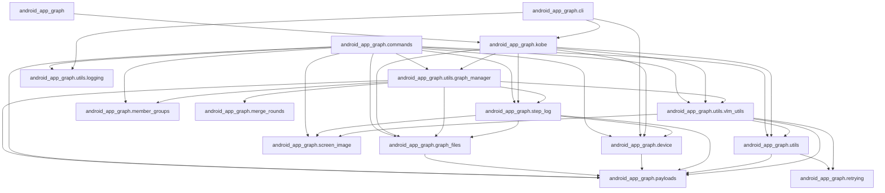

# Android-App-Graph

Android-App-Graph explores Android apps into UI state-transition graphs. It is a
fork of [UI-KOBE](https://github.com/YuxiangChai/UI-KOBE) by Yuxiang Chai.

## How It Works

1. **Explore an app.** Android-App-Graph opens an Android app on an emulator, observes the
   current screen, chooses an exploration action, and records the result.
2. **Build a graph.** Each screen of the app becomes a graph node, and what
   changes on it, such as a scrolled list or an open menu, is that node's state.
   Actions that move the app between states become graph edges.
3. **Audit and plot the graph.** `app-graph-audit` finds duplicate nodes and
   mislabelled edges and can correct them on the device; `app-graph-plot` draws
   the graph.
4. **Build again from the log.** `app-graph-build` builds a new graph from the
   recorded screenshots and actions, without a device, under other matching
   settings.

## Repository Layout

```text
Android-App-Graph/
├── src/
│   └── android_app_graph/             # The installable package; the only directory in the wheel
│       ├── cli.py                     # app-graph command
│       ├── commands/                  # app-graph-audit, app-graph-build, app-graph-plot
│       ├── kobe.py                    # Core app explorer
│       ├── screen_image.py            # The WebP encoding every screenshot gets when taken
│       ├── step_log.py                # Records every screenshot and action in steps/
│       └── utils/                     # Graph, VLM, and logging helpers
├── scripts/                           # Operator scripts, not packaged
│   └── run_explore.sh                 # Auto-resume wrapper around app-graph
└── configs/
    └── explore.yaml                   # Sanitized exploration demo config
```

`src/android_app_graph/` is the installable Python package: `uv build` produces a wheel
that contains the `android_app_graph` import package and nothing else.

`scripts/` and `configs/` deliberately stay at the repository root and are not
part of the wheel. `scripts/` holds only `run_explore.sh`, a shell wrapper
around the `app-graph` console script; the `app-graph-audit`, `app-graph-build` and
`app-graph-plot` commands live in `src/android_app_graph/commands/` and ship
with the wheel. `configs/` holds example configuration.

Generated graphs, logs, and outputs are intentionally ignored by git.

### Module map

Import direction inside `src/android_app_graph/` is enforced by `tach check`
(part of `uv run --locked poe check-fast` and `poe check`) from `tach.toml`.
Arrows point from importer to imported module; anything not drawn is forbidden.



## Prerequisites

- Python >= 3.14. `.python-version` pins `3.14`; uv downloads a managed
  interpreter automatically if none is installed.
- [uv](https://docs.astral.sh/uv/) 0.12.9 or a newer 0.12.x release.
  `pyproject.toml` enforces the range `>=0.12.9,<0.13` with `required-version`;
  run `uv self update 0.12.9` if yours is outside it.
- Android SDK with `adb` on `PATH`
- A device running Android 16 (API 36) or later, listed by `adb devices` with the
  target app installed. This can be an emulator, an Android container such as
  Redroid, or a device with USB debugging enabled. `device.udid` in the config is
  its serial. `device.avd_name` is read only when `adb devices` lists nothing:
  exploration then copies that AVD to `<avd_name>_dup` and starts the copy with
  `emulator`, which must be on `PATH`. The source AVD's `.ini` file must declare a
  non-empty `target`; the copy preserves that target. When `adb devices` fails or
  times out, adb cannot reach its server, and `app-graph` copies and starts nothing:
  it exits with status 1 and an error naming
  the server's address, `ADB_SERVER_SOCKET` or else
  `tcp:<ANDROID_ADB_SERVER_ADDRESS>:<ANDROID_ADB_SERVER_PORT>`, by default
  `tcp:localhost:5037`, and adb's error or the timeout. `device.unreachable_limit`
  is how long exploration waits for a device that stops answering (see
  [Device outages](#device-outages)).
- VLM provider credentials exported as environment variables

## Install

```bash
git clone https://github.com/john-agi/Android-App-Graph.git
cd Android-App-Graph
uv sync
```

Run commands through `uv`:

```bash
uv run app-graph --help
```

## Configure API Credentials

Do not put API keys directly in config files. Use a local `.env` file instead:

```bash
cp .env.example .env
```

The official [OpenRouter Python SDK](https://openrouter.ai/docs/client-sdks/python/overview)
is installed by `uv sync --locked`. OpenRouter is the only endpoint and
`OPENROUTER_API_KEY` is the only credential: one key covers chat, text embeddings
and screenshot embeddings, and a missing or empty key is an error:

```bash
OPENROUTER_API_KEY=your-key
```

Two optional variables, commented out in `.env.example`, attribute your requests to
your app in OpenRouter's rankings and analytics
([app attribution](https://openrouter.ai/docs/app-attribution)):
`OPENROUTER_HTTP_REFERER` (your app's URL) and `OPENROUTER_X_OPEN_ROUTER_TITLE`
(its name). The OpenRouter SDK reads them from the environment and sends them as
the `HTTP-Referer` and `X-OpenRouter-Title` headers.

Export `.env` into the environment before running commands:

```bash
set -a
source .env
set +a
```

`.env` is ignored by git. Keep all four model selections from
[`.env.example`](.env.example), or replace them with exact OpenRouter model IDs.
The application has no built-in model defaults. Each operation requires explicit,
nonempty model settings. Before any device setup or API request, `app-graph`,
`app-graph-audit` and `app-graph-build` reject every config key that no command
uses, naming each by its path, such as `vlm.action.max_tokens` or `apps[0].activity`, and
validate every setting the operation uses (models, temperatures, timeouts and
`OPENROUTER_API_KEY`); they report the problems in a one-line usage error.
`CONFIG_KEYS` in `src/android_app_graph/utils/__init__.py` lists the accepted
keys. You may also supply these environment variables directly in your shell, CI
or container; a physical `.env` file is not required or loaded automatically.

| Environment variable | Role |
|---|---|
| `APP_GRAPH_PAGE_DETAIL_MODEL` | Screen descriptions and graph auditing |
| `APP_GRAPH_EMBEDDING_MODEL` | Text and screenshot embeddings |
| `APP_GRAPH_INSTRUCTION_MODEL` | Exploration planning and relabelling flagged edges |
| `APP_GRAPH_ACTION_MODEL` | Action prediction |

The template's model selections were approved from OpenRouter's catalog based on
documented capabilities, the chat models on 2026-10-12 and the embedding model on
2026-10-21; their performance on Android tasks has not been measured.
Check a replacement model's supported input modalities and parameters in the
[chat catalog](https://openrouter.ai/api/v1/models) or
[embedding catalog](https://openrouter.ai/api/v1/embeddings/models).

The sample YAML uses `${APP_GRAPH_*_MODEL}` references. An omitted `model` field
reads the corresponding environment variable; an explicit model ID in YAML takes
precedence. An empty value or unresolved reference is an error.
To compare models, edit `.env`, export it again and restart the command.

Exploration requires every role: `page_detail`, `embedding`, `image_embedding`,
`instruction` and `action`. A basic audit requires `page_detail`, `embedding` and
`image_embedding`; `--re-explore` also requires `instruction` and `action`. A
[build](#build-a-graph-from-a-step-log) requires `page_detail`, `embedding` and
`image_embedding`, whose model only names the log's vectors it reads.
`image_embedding` embeds screenshots and takes the `embedding` model when its block
sets none (see [Requests and recovery](#requests-and-recovery)),
so the four variables above cover every role. Help and plotting existing graphs need
no model configuration or credentials.

Each chat role (`page_detail`, `instruction`, `action`) accepts an optional
`temperature` in its YAML block: a finite number from 0 to 2, inclusive, or an
`${ENV_VAR}` reference.
It is omitted by default. Only set it when the selected model and provider
support it; check the model's supported parameters and
[OpenRouter's parameter guidance](https://openrouter.ai/docs/api_reference/parameters).
The sample `configs/explore.yaml` sets `temperature: 0.0` on `action` only:
`qwen/qwen3.8-flash` supports it, while Sol, the sample's page-detail and
instruction model, rejects temperature, so those blocks leave it out. Zero
temperature does not guarantee deterministic output.

### Requests and recovery

Each call type has its own request timeout, the seconds one attempt may take, sent
with each request:

| Call | Call type | Role | Timeout |
|---|---|---|---|
| Screen description | `page_describe_and_state` | `page_detail` | 55 s |
| Node verification | `node_verify` | `page_detail` | 35 s |
| Edge normalization | `normalize_edge` | `page_detail` | 50 s |
| The coverage checkpoint's target choice | `exploration_target` | `page_detail` | 25 s |
| Node-merge audit and graph audit | `node_merge_audit`, `graph_audit` | `page_detail` | 300 s |
| Exploration planning | `instruction` | `instruction` | 70 s |
| Relabelling a flagged edge | `action_description` | `instruction` | 70 s |
| Action prediction | `action` | `action` | 35 s |
| Text embedding | `embedding` | `embedding` | 15 s |
| Screenshot embedding | `image_embedding` | `image_embedding` | 15 s |

A role's positive, finite `request_timeout` (or `timeout`) in seconds replaces these
for every call of the role. A screenshot embedding takes the `embedding` block's
timeout when the `image_embedding` block sets none. The graph audit and node-merge
audit send the whole graph in one prompt, so they take
`page_detail.audit_request_timeout` instead, default 300 seconds.

Each attempt ends at that timeout by the wall clock, counted from when the
request is sent, so connecting and the response headers count too. httpx's own
read timeout applies to each chunk of data, and OpenRouter keeps a non-streaming
connection open with whitespace every few seconds while the model works, so that
timeout alone would never fire. A connection that sends nothing at all still ends
at httpx's read timeout.

The OpenRouter SDK retries nothing itself: the application sends a request again
after an attempt that times out, drops its connection (refused, reset or failed
reads and writes), or is answered with 429 (too many requests) or a 5XX status. It
waits as long as the response's `Retry-After` header asks, in seconds or as a date,
when that is positive and ends by the deadline, and otherwise an exponential
backoff (0.5 s, then ×1.5 per retry, plus up to 1 s of jitter, at most 60 s
between tries) cut short to end at the deadline. The deadline is twice the call's
timeout after its first attempt, so a timed-out attempt gets exactly one more, and
no attempt starts after it. Each failed attempt logs a warning naming the call, the
attempt's number and how long it took, then when it is sent again
(`node_verify: attempt 1 timed out after 35.0 s; sending again in 1.2 s`) or, for
one that ends past the deadline, that it is the last
(`node_verify: attempt 2 timed out after 35.0 s; its deadline has passed`), so the
log shows every hung attempt and how often the provider limited the run. The last
attempt's error then propagates. Other 4xx responses, including 402 (no credit
left), fail at once, as does a server that closes the connection without sending a
response. Only node verification asks again after the deadline: a verifier request
that still times out is sent once more, with a deadline of its own. Any other call
that still times out takes the fallback listed below for a truncated reply, and a
call without one raises. OpenRouter bills a non-streaming request in full even after
the client disconnects, so an attempt cut off at its deadline is still billed, and a
timeout shorter than the model needs pays for the same request twice.

The application asks a model once more, and only once, for output it cannot use:
a malformed page description, an action reply that cannot be parsed or converted,
an SDK validation failure on a 2xx response, an empty or non-finite embedding
vector, or a reply whose generation failed partway (`finish_reason: "error"`). If
the second attempt is unusable too, an action falls back to a one-second wait and
everything else raises; a failed generation never becomes a parse fallback.
Exploration counts waits toward `max_steps`, including recovery waits, so repeated
malformed actions cannot keep the run alive indefinitely.

An action reply that cannot be parsed or converted is asked again with what was
wrong, since at temperature 0 the same request can repeat the same mistake. The
second request repeats the instruction and screenshot, adds the failed reply as an
assistant message (omitted when the reply has no text), and ends with a user
message naming the problem: the `<tool_call>` block used `<function=...>` tags
instead of JSON, there was no `<tool_call>` block with valid JSON, or the
`mobile_use` arguments were invalid, quoting the conversion error. It then asks for
Thought, Action and one `<tool_call>` block of JSON, at the role's usual
temperature. Every other unusable reply, including a failed generation and an SDK
validation failure, is sent again unchanged.

No request sets `max_tokens`, so a reply stops only at the model's own output
limit. A reply cut off there (`finish_reason: "length"`) is never asked again,
since the same request would be cut off again. The log names the call and any
reasoning tokens, and the caller applies its final fallback at once: an action
waits, node verification reports no answer, edge normalization
and relabelling a flagged edge keep the instruction, the audits report no
issues, the coverage checkpoint uses its top candidate, and a page description
or an exploration plan raises. A call that still times out at its deadline takes
the same fallback, so an action waits too; a page description, an exploration plan
or an embedding still raises. A reply stopped by the provider's content filter
(`finish_reason: "content_filter"`) is logged with the call's name and otherwise
handled like any other empty or partial reply.

Node verification also reports no answer for a reply it cannot parse, and logs
each one as `node_verify: no answer` with its cause. No answer changes nothing in
the audit: a merge check, the audit's or the coverage checkpoint's, keeps the two
nodes apart and decides no other pair, and a split or move check leaves the node
whole (see [Merge proposals](#merge-proposals) and [Member checks](#member-checks)).
Screen matching counts it as a rejection (see [Screen matching](#screen-matching)).

The page-detail calls that return JSON (screen descriptions, node verification,
edge normalization, both audits and the coverage checkpoint's target choice),
the exploration planner, which names the unexplored element its instruction acts
on, and the instruction model's relabelling of a flagged edge ask for
[structured outputs](https://openrouter.ai/docs/guides/features/structured-outputs):
a JSON schema with a description of every property, plus OpenRouter's
[response-healing](https://openrouter.ai/docs/guides/features/plugins/response-healing)
plugin. The schemas are strict except for screen descriptions and edge templates,
whose `state` and `params` objects have free-form keys that strict mode cannot
express. OpenRouter routes a `response_format` only to providers that support it,
and not every provider enforces strict schemas, so the application validates every
reply itself. The action model replies in its own text format.

Chat responses must include every field the SDK requires, including
`system_fingerprint`, which may be `null` but not omitted. A broken endpoint
response cannot become an action's fallback wait.

Exploration, `app-graph-audit` and `app-graph-build` log a usage summary when they finish, per call
type and model: calls, prompt tokens and the cached share of them, completion
tokens and the reasoning share of them, total tokens, and cost in USD, as reported
by OpenRouter's [usage accounting](https://openrouter.ai/docs/guides/administration/usage-accounting).
For a request OpenRouter sends with your own provider key (BYOK), the cost adds the
provider's bill for it, `upstream_inference_cost`, to OpenRouter's charge, so it is
the full price even though the provider bills that part to your key directly.
Every completed reply counts, including one that was asked again or cut off,
since OpenRouter bills it; embedding replies report cost but no cached or
reasoning tokens.

Each command opens one OpenRouter client for the whole run, shares it across every
role and closes it when the run ends; each request carries its own role's model
and temperature, and its call type's timeout.

Edge normalization sends up to 16 requests at once: exploration's pass over a
node's outgoing edges at every tenth visit and its final pass over every edge,
and the audit's pass over every edge. The audit's merge and member checks send
each round of verifier questions the same way (see [Merge proposals](#merge-proposals)
and [Member checks](#member-checks)). Each request keeps its own timeout, retries
and fallback as above, and logs its own warnings, such as a timeout or a 429 sent
again, when they happen. The results are applied and logged in the order of the
edges or questions, whichever request is answered first, and the usage summary
counts every request. A request that raises, such as one refused for lack of credit
or still answered with 429 at its deadline, cancels the requests not yet sent; the
templates of those already answered are still written, and then the error stops
the command.

Every adb command has a timeout too: see [Device outages](#device-outages).

Screenshots are embedded through OpenRouter's
[multimodal embeddings API](https://openrouter.ai/docs/api_reference/embeddings), as
`image/webp`. `vlm.image_embedding` inherits the `embedding` model and timeout when
omitted; set its `model` or `request_timeout` to embed screenshots differently.
Image embeddings require an image-capable embedding model, such as the one in
`.env.example`: a text-only model fails the first screenshot request, which stops
the command.

### Embedding caches

Screenshot and description vectors are both kept by observation, in files of the form
`{"model": model_id, "embeddings": {observation_id: vector}}`. A damaged file stops
exploration or the audit as it loads the graph, before any member is embedded, with an
error naming the file and the damage: the file cannot be read or parsed, has no model
tag or no `embeddings` object, or holds a malformed or non-finite vector, named by
observation. Nothing is pruned, since observation IDs never change.

Screenshot vectors live in the [step log](#step-log), `steps/image_emb.json`, so the
explored graph and its audited copy share them: a screenshot's vector depends only on
the screenshot and the model. Every screenshot that
[screen matching](#screen-matching) takes is embedded once and kept. Nothing reads
the vector of any other screenshot, so none is made for the screens of other apps,
including one a Back press leaves in front, or for a screenshot read without being
matched, such as the one after a wait. A file tagged with another model counts as
empty after one warning.

Description vectors live beside the graph file, in `<graph file stem>_text_emb.json`:
`<app_name>_text_emb.json` for the explored graph and `<app_name>_audited_text_emb.json`
for the audited copy, which starts from the explored graph's. A description depends on
the other screens' descriptions in its prompt, so its vector belongs to one graph. An
in-app screenshot the description model describes keeps the vector of the description
it ends with: its [`describe`](#screen-matching) output's `page_description`, or the
description the step's first rejection refined it to
(`identify.refinement.new_description`). An exact match copies its member's vector
without a request. The file is written with the graph, just before it.
Nothing embeds a description again, so a graph loads only with the vector of every
member of an in-app node but a [black](#step-log) one, which is never described and
which every reader of these vectors leaves out: a missing file, one tagged with
another model, or one without such a member's vector stops exploration or the audit
as it loads the graph, with an error naming the file and the problem.

When exploration resumes a graph and when the audit loads one, every member of an
in-app node that has no image vector is embedded first, as when `image_emb.json` is
missing or tagged with another model. The log names the count before and the cost
after. To embed every screenshot again, delete the file.

One 670x1490 WebP screenshot, embedded with `voyageai/voyage-multimodal-3.5`, was
1,782 prompt tokens and $0.000599 on 2026-10-21; Voyage bills images by pixel, so a
screenshot of at most one million pixels costs at most about $0.0006.

### Action responses

The action prompt declares the `mobile_use` function in its text format and gives
the screen resolution as 999x999 whatever the device or screenshot size; the
screenshot itself is still downscaled to at most one million pixels.
On ScreenSpot-v2 mobile (501 screenshots, temperature 0), `qwen/qwen3.8-flash`
hit the target in 94.2% of taps with that screen line.

A `<tool_call>` block holds one JSON object, `{"name": ..., "arguments": {...}}`
or the arguments alone. A reply that ends before `</tool_call>` is still read when
its JSON object is complete. The `<function=mobile_use>` form, with one
`<parameter=name>` tag per argument, is not read: like any other reply that yields
no action, it is [asked again](#requests-and-recovery) with the reason.

Textual and native tool calls use the same action conversion. Click and long-press
coordinates must contain two finite numbers on the model's 0–1000 scale, which
are scaled to device pixels. A swipe uses two complete coordinate pairs when
provided; otherwise `up`, `down`, `left` or `right` works with omitted, null or
one valid coordinate pair. Supplied malformed coordinates still trigger
[action recovery](#requests-and-recovery). For swipes and long presses, a
numeric `time` takes precedence over `duration`; the default is 1000 milliseconds.
System buttons `Back`, `Home`, `Menu` and `Enter` become `back`, `home`, `menu` and
`enter` actions. Menu opens the application's options menu with `KEYCODE_MENU`;
graph actions, step logs and replay preserve the `menu` action.
Unsupported swipe directions, unknown actions or system buttons, and type
actions without a text string trigger the same bounded action recovery.
Explicit `end` and `terminate` become an `end` action, which exploration and the
audit record as a back press.

## Explore an App

Edit `configs/explore.yaml` for your emulator and target app:

```yaml
device:
  udid: emulator-5554
  avd_name: AndroidWorldAvd

apps:
  - name: demo_app
    package_name: com.example.app
```

Run exploration:

```bash
set -a && source .env && set +a
uv run app-graph -c configs/explore.yaml
```

Useful options:

```bash
uv run app-graph -c configs/explore.yaml --max-steps 100
uv run app-graph -c configs/explore.yaml --resume-from auto --max-steps 50
```

Exploration writes graph files under `graphs/<app_name>/` and records every
screenshot and action in its [step log](#step-log).

Each step's planner is given the screenshot, the screen's description, the elements
on it not acted on yet, and the instructions already tried from the screen's node.
It is told where each action of an edge to another node led, by that action's target
observation. The node's self-loop, the actions that stayed on the screen, gains an
action for every state the screen can be put in, such as each day an alarm repeats
on, so the planner is given only its 30 most recent distinct instructions, without
where they led, and then how many more were tried. However many actions the
self-loop collects, the prompt grows only with the actions of edges to other nodes.
`app-graph-audit --re-explore` plans with the same prompt.

When the last 15 steps planned on a node were all self-loops on it, the next step
there plans nothing: it [continues from a ranked target](#replaying-to-a-node), as a
step that plans Back where Back leaves the app does. A step to another node and such
a continuation start the count again, and a step that waits leaves it as it is. The
count is kept in memory, so a resumed run starts it at zero. Both bounds are
`SELF_LOOP_INSTRUCTIONS_LISTED` and `SATURATING_SELF_LOOP_STEPS` in
`src/android_app_graph/utils/vlm_utils.py`.

Every step that counts toward `--max-steps` logs a `Step N/M: <from> --[<action>]--> <to>`
line and then the tokens it used. `<to>` is `ext_<package>` for a step into another
app and `ext_web` for one onto [outside web content](#external-apps-and-web-pages).
A step that only waits shows `wait` as its action, a step that
[continues from a ranked target](#replaying-to-a-node) shows `continue`, with the node
it continues from as `<to>`, and a step a [device outage](#device-outages) interrupted
shows `interrupted`, with the node of the screen the device shows when it answers again
as `<to>`. A run that continues a graph with completed steps first logs the step it
resumes from and the target total.

Exploring an app starts by clearing recent apps. The explorer opens the app switcher,
finds Clear all in the switcher's UI dump by Launcher3's resource id
`com.android.launcher3:id/clear_all` or by its text, "Clear all" in any case, and taps
it. Until Clear all appears it swipes the list from left to right, one app per swipe,
at most 10 times; then it logs a warning, presses Home and explores with the recent
apps left. When the switcher shows no app, its overview panel without an app card, the
explorer presses Home at once.

Before exploring, and before `app-graph-audit --re-explore`, the app is granted
every permission it requests with `adb shell pm grant`, so no permission prompt
interrupts exploration. The grants stay on the device. Permissions that
`pm grant` refuses, such as `INTERNET`, are logged and skipped.

The app is then launched with `adb shell am start -n <component>`. The component is
the app's optional `launch_activity` (`<package>/<activity>`) when the config sets
one, and otherwise the package's launcher activity, which
`adb shell pm resolve-activity` names; every [restart](#replaying-to-a-node) of the run
starts the same component. A package with no launcher activity and no
`launch_activity`, or a component `am start` cannot start, stops the run with an error
naming it. Clearing recent apps and launching both work on devices without hardware
keys, such as Redroid containers.

For long runs, use the auto-resume wrapper:

```bash
./scripts/run_explore.sh -c configs/explore.yaml
```

### Replaying to a node

`--resume-from`, the coverage checkpoint every `experiment.coverage_checkpoint_steps`
steps, a step that continues from a ranked target (below) and each issue that
`app-graph-audit --re-explore` works on reach their node by replaying recorded actions
from the screen the app opens on. Before every replay the
app is force-stopped (`adb shell am force-stop <package_name>`) and launched again
with its task cleared (`adb shell am start -n <component> -f 0x10008000`), so another
app's screen left in that task, such as a search screen the app opened, does not come
back. The component is the app's `launch_activity` when the config sets one, and
otherwise the package's launcher activity, looked up once per run; of several, the
first is used and a warning names the others. A component that `am start` cannot
start raises an error naming it and adb's error. Whatever the app holds only in
memory, such as an unsaved form, is lost at each replay; data it has stored survives.

Some apps open on the screen used last rather than on their start screen, the screen
the app opened on when exploration began: Clock opens on the tab used last, even with
its task cleared. So after the launch the replay identifies the screen, expecting the
start screen. When it is another node and recorded actions lead from that node to the
target, the replay starts there, and otherwise from the start screen; a log line names
the node whenever it is not the start screen.

The replay follows the path that sends the fewest device actions, each edge
weighed by its cheapest action: the action's own steps and its
[setup](#graph-edges), so a path whose actions need no setup is preferred. On
each edge it sends that action's setup first, the actions that put the screen
in the state exploration sent the action in, such as the swipe that scrolled a
list, the tap that opened the menu an option is on, or the choice in a dialog
that filled in a form. What exploration did on the screen and undid before the
action, such as opening a row and pressing Back, is not part of the setup, so
the replay does not send it. Exploration's log names each setup action, as in
`Replay 2/3: setup 1/1 on s30 via swipe`.

An action whose setup is unknown was sent in a state the replay cannot rebuild,
except for the menu open over the screen, which the action records (see
[Graph edges](#graph-edges)). When a menu was open, such as the navigation drawer
whose row the action taps, the replay first opens it with a recorded self-loop
action of the screen that opened that menu, the one that sends the fewest device
actions with its own setup; one whose setup is unknown counts only when it was sent
with no menu open, as a replay arrives. The opening counts toward the action's
weight like a setup, and the log names its actions as setup actions. An action sent
in a menu that no recorded action opens is in no path.

`--resume-from auto` resumes from the node the coverage checkpoint's ranking puts
first, without a model call. The ranking holds the nodes a replay from the start
screen can reach, and favours nodes with many unexplored elements, few outgoing
edges and few visits. Each checkpoint lets the model choose among the
`experiment.coverage_checkpoint_top_k` highest-ranked nodes, and also offers the
app's start screen while it has unexplored elements, in the last of those places
when it ranks below them.

Back on the start screen leaves the app for the home screen, as does Back on the
screen an app opens on instead, and exploration then restarts the app onto the same
screen. So on the start screen and on a screen with an edge by Back to an `ext_` node,
where Back has already left the app, the planner's prompt says that Back there leaves
the app and asks for an action on the screen; `app-graph-audit --re-explore` plans with
the same prompt. When an exploration step still plans Back there, or its action model
answers `end` there, which exploration records as Back, Back is not pressed.
The explorer chooses a node as a checkpoint does, among the ranked nodes other than
the step's screen but without the checkpoint's merge audit, replays to it and
continues from it. The step counts toward `max_steps`, and its log line names the
node. In the step log, the replay's records have the `source` `navigation_replay` and
the screen read after it `coverage_checkpoint`. When no other node is ranked, Back is
pressed. A step on a node whose last 15 steps were all self-loops continues from a
ranked target the same way, before it plans (see [Explore an App](#explore-an-app)),
and plans as usual when no other node is ranked.

When a replay for `--resume-from`, a checkpoint or a continuation from a ranked target
lands on a node other than its target, from whichever screen it starts, it counts a
miss on the target, saved in the graph file as the node's `replay_misses`. The ranking
leaves out a node whose last replay missed, so `--resume-from auto`, a checkpoint and
a continuation pass it over, until exploration records a new action
into that node from another one, which can give the replay another way there, and
clears its `replay_misses`. Reaching the node again with an action already recorded,
or an action that stays on it, leaves it out. The start screen is never left out: its
replay is the app's launch.

### External apps and web pages

A step that opens another app records an edge to an `ext_<package>` node. A step
that opens web content from outside the app, such as a browser or custom tab
showing an address bar or URL, records an edge to the single shared `ext_web`
node. Either way the element the step acted on is marked explored, as after a
step that stays in the app, and the explorer then presses back. A redirecting
link or a browser's
own history can keep an outside web page up, so the explorer presses back again,
a few times at most, and if the page is still showing restarts the app as before
a [replay](#replaying-to-a-node). Back can also leave another app in front, for
example when it only closed that app's keyboard. The explorer then restarts the
app the same way, force-stopping it before the launch, because a launch alone
resumes the app's task with the other app's screen still on top. If another app
is still in front after the restart, exploration stops with an error naming its
package. No screen of another app gets a node: whenever another app is in front
when the explorer identifies a screen, such as at the end of a replay, it restarts
the app first, and stops with the same error if the app does not come back. It
never records an edge out of an `ext_` node, so a replay never passes through one.
The screen-description model decides what
counts as external web, so the app's own screens get regular nodes even when they
run in a web view or mention a privacy policy. A permission prompt or system dialog
belongs to another package but sits on top of the app, so it gets a regular node
and no back press. The keyboard also belongs to another package; a page with the
keyboard shown shares the page's node, and the keyboard's visibility is recorded
in the node's state.
`app-graph-audit --re-explore` records external web pages and these dialogs the
same way. A re-explore step that opens another app records nothing; the audit
presses back, restarts the app if another app is still in front, and stops with
the same error if the restart does not bring the app back.

Every node other than an `ext_` one records the package the device reported for
its screen, and the explorer and the audit match a screen only with nodes of its
package. A dialog's node is therefore never a target of
`--resume-from auto` or the coverage checkpoint, which replay from the screen the app
opens on.

### Device outages

Every adb command has a timeout. An input (a tap, swipe, key press or text) is
stopped after 15 seconds, the check whether the keyboard is up and the device check
below after 3, and every other command after 30. A command that works ends well
within its timeout: the slowest, a UI dump that gives up waiting for an idle screen,
takes about 12 seconds.

Every read of the screen, in exploration and in the audit, runs three adb commands:
the UI dump, the screenshot and `dumpsys window`. Each one that times out is run
once more, with a warning naming the command (`adb ... timed out after 30 s;
retrying once`). An input that times out is not sent again: it may have reached the
device, and sending it again could act twice.

When a read times out the second time, or an input or another adb command of an
exploration step times out, the explorer logs the command and starts one recovery
deadline: `device.unreachable_limit` seconds, 1800 (30 minutes) by default. Recovery
checks the shell with `adb shell true`, then captures the complete UI dump,
screenshot and window state. A successful shell check leaves that deadline in
force. Each probe, observation read, retry and 30-second interval uses the time
remaining. Recovery finishes when the complete observation succeeds; identification
then runs with its model-request policy, and exploration continues from that screen.

During recovery, the three observation reads may also exit nonzero. Offline or
closed adb transports and `android.os.DeadObjectException` are retried within the
same deadline. Permission denials, invalid options, unknown or unsupported commands,
and missing services stop the run. An unclassified nonzero result gets one
confirmation observation after the recovery interval; another unclassified result
in the same episode stops. The recovery log names the device, read phase, command
and exit status, with up to 1024 characters of error diagnostics or `diagnostics
absent`. Screenshot bytes and successful observation payloads stay out of that log.

The interrupted step counts toward `--max-steps`, and
its `Step N/M` line shows `interrupted` as its action. What its action did is
unknown, so a step interrupted before it recorded its edge records none, and the
[setup](#graph-edges) of the next action is unknown. An outage after the step was
counted, such as one during the coverage checkpoint that follows it, counts no other
step. In the step log, the screen read after the outage has the `source`
`device_recovery`.

Past the limit, exploration saves the graph and logs `Device <udid> unreachable for
<N> minutes. Exploration stopped at step <n>. Graph saved. Re-run to resume.`, and
`app-graph` exits with status 1 and `app-graph: error: Device <udid> unreachable for
<N> minutes`, without a traceback; `scripts/run_explore.sh` then starts it again,
resuming from the saved graph. Only the exploration loop waits: an adb command that
times out as a run starts, or in `app-graph-audit`, stops the command with its
error. The explorer never restarts the adb server, which other runs can share.

### App input boundaries

Action grounding uses each capture's native display dimensions, including rotation.
Before every app tap, hold or swipe, the device reads its current window insets.
Taps and holds stay outside visible system touch regions; swipes start outside
system gesture regions. A visible gesture navigation bar can pass ordinary taps
through to app content. Keyboard keys and unobscured app controls stay available.

Reveal a partly obscured control or choose an unobscured point on that same control.
An unreachable coordinate, unavailable geometry or a display change defers the
input with a recorded reason. Exploration counts one wait without marking the
target explored; replay stops and identifies the screen reached. Audit retries
report the skipped action. Coordinates are never moved to another control.

The detection uses the default display's authoritative `InsetsState` in
`dumpsys window`. Its visible `tappableElement`, `systemGestures` and
`mandatorySystemGestures` sources define the regions, rather than fixed margins.

### Step log

Exploration and `app-graph-audit --re-explore` record every screenshot they take,
every action they send, every screenshot they ask a node for and every edge they
give the graph in `graphs/<app_name>/steps/`, which the explored graph and its
`_audited` copy share. Recording is always on. A record never changes once written:
what placed a screenshot on its node belongs to one graph and goes to that graph's
identify file (see [Screen matching](#screen-matching)).

Each step has a zero-padded number. Its record is `<id>.json`, and a screenshot
also has its image, `<id>.webp`. Every screenshot is encoded once, when it is
taken: shrunk with LANCZOS to at most one million pixels and saved as lossless
WebP. That image is the only copy kept: the models receive it and the graph refers
to it. The image is written before its record, so every record names an
image that exists. A later run continues the numbering after the highest record,
and an image a crash left without a record is ignored and its number reused.
`image_emb.json` beside them holds the screenshots' image vectors (see
[Embedding caches](#embedding-caches)).

Every record has `id`, `kind`, `run_id` (one per exploration or re-exploration
run), `run_kind` (`explore` or `audit`), `source`, a UTC `timestamp`, and the
`activity` and `package` of its screen:

| `kind` | Written for | Also holds |
|---|---|---|
| `observation` | each screenshot | `width` and `height` of its image, the `status_bar` frame, `status_bar_rows`, `pixel_hash`, `black` and captured `input_regions` |
| `action` | each requested device action, written before dispatch | `observation`, the run's latest screenshot before it (`null` when the run has none), and the `action` |
| `action_rejected` | each unreachable app coordinate input, with no input dispatched | `action_record`, the rejected request's ID, its `action`, the `reason` and current `input_regions` |
| `match` | each screenshot the run asks [screen matching](#screen-matching) to place, written before it is placed | `observation`, that screenshot, and `expected_observation`, a screenshot of the screen the run expects it to show, or `null` |
| `transition` | each edge the graph is given | `before` and `after` observation IDs, the planner's `instruction` and `element`, the executed `action`, and `from_node` and `to_node` as they were then |

An action, match or transition record takes `activity` and `package` from the
screenshot it was taken from. A replay acts without looking, so a replayed action
names the last screenshot before it, which can predate the app restart. The
planner's instruction can differ from the edge's: an action-model `end` is recorded
on the edge as "Press back".

A screenshot read without being matched, such as one of another app or the one after
a wait, has no `match` record. `expected_observation` names a screenshot, never a
node, so any graph built from the log maps it to its own node: the earliest member of
the node a replay leads to, of the start node after a restart, or of the target of
the audit's retried edge, and, when Back closes an outside web page or another app,
the screenshot the run last matched before the step, which shows the screen the step
started from.

The status bar's clock and icons change on their own, so `pixel_hash` leaves them
out. It is the SHA-256 of the image's decoded pixels, mode and size below its top
`status_bar_rows` rows. Those rows cover `status_bar`, `[left, top, right, bottom]`
in screen pixels, which every capture reads from the `statusBars` `InsetsSource`
of the `dumpsys window` output it already reads for the package and activity:
`ceil(bottom * image height / screenshot height)`, and
3 rows more when encoding shrank the image, because shrinking with LANCZOS blends
each row into the 3 rows on either side of it. The frame follows the display cutout and the rotation; on a Pixel 9
emulator it is 142 of 2424 rows in portrait. A bar that is hidden, as in immersive
mode, not at the top, or not reported gives `null` and 0 rows, and the whole image
is hashed, which can miss an exact match but never invents one.

`black` is `true` when no colour channel of any pixel of the image is above 8 of
255. Android keeps a window flagged
[`FLAG_SECURE`](https://developer.android.com/reference/android/view/WindowManager.LayoutParams#FLAG_SECURE),
such as the screens that set a lock-screen pattern, PIN or password in Settings, out
of screenshots, and `screencap` captures it with every pixel 0.

`source` names the part of the run that took the step: `main_loop`,
`navigation_replay`, `coverage_checkpoint`, `external_app_recovery`,
`external_web_recovery`, `device_recovery` (the screen read after a
[device outage](#device-outages)), `re_explore` (the audit's exploration steps) or
`edge_retry` (the audit's replay of a flagged edge). A retried edge has no
planner, so its transition holds the flagged instruction and a `null` element.

On 139 screenshots of the Settings app from a 1280x2856 emulator, each became a
669x1493 image of 74 KB on average (176 KB at most) and took about 0.35 s to
encode. A record is a few hundred bytes, and a screenshot's line in an identify file
about 2 KB; each vector in `image_emb.json` adds about 14 KB.
The log keeps every value shown on the screen and every text typed, passwords
included, so treat a graph directory like the app's data. Run one exploration or
re-exploration of an app at a time: two runs writing one step log reuse each
other's numbers.

### Text input planning

Exploration and audit planning receive the current screenshot description's focused
field separately from OS keyboard visibility. The focus report distinguishes a named
field, `null` (no field identified), and an absent report. It comes from the current
observation or an exact image match.
The planner uses that report and the current caret or field highlight to identify
where text goes. When the intended field's focus is unclear, it taps that field as
one step and observes the result before typing. An already identified active field
can receive text directly.

On the [supported Android versions](#prerequisites), Type replaces the complete focused
value as one recorded action. It targets standard editable fields that handle Android
Select All and delete keyboard editing: a keyboard Ctrl+A combination selects the value,
one Delete removes it, and the requested text is entered with shell quoting and virtual
keyboard character support.
Replacement is independent of the previous value's length, caret position and selection.
Custom widgets, intercepted shortcuts and other IMEs are outside the validated support.
An adb command's successful exit reports command acceptance, without acknowledging
the widget's selection or resulting value. A clearing-command error or timeout stops
Type before text entry. Input is never retried because it may already have reached
the field.

### Graph nodes

A node is a screen by its purpose. What changes on a screen without changing its
purpose is the node's state, which the screen description model records on each
visit: whether the on-screen keyboard is shown (`keyboard_visible`), the focused
field (`focused_field`), how far a list is scrolled (`first_visible_item` and
`last_visible_item`), the overflow menu, dropdown, picker, popup or context menu
open over the screen (`open_menu`, naming the menu, or `null`), and which sections
are expanded (`expanded_sections`). The verifier counts screens that differ only in
these as the same screen. So opening or closing a menu is a self-loop whose
`schema_deltas` entry records `open_menu`, choosing an option that keeps the screen
is a self-loop recording the value it changed, and choosing one that leaves the
screen is an edge to where it leads. A menu's options join the screen's elements as
rows revealed by scrolling do, and an option's action records the tap that opened
the menu in its [setup](#graph-edges), or, when its setup is unknown, the menu it was
sent in, so a replay opens the menu before choosing the option. A dialog, bottom
sheet or full-screen picker that has its own purpose, such as a data usage warning
dialog, is a node of its own, and a menu open over it is that node's state.

A destination the app names in its own navigation, such as a tab, a bottom
navigation bar item or a navigation drawer entry, is a node of its own too, even when
it shares its layout and purpose with another: Files' Downloads, Recent and Internal
storage are three nodes. Content inside one destination, such as a subfolder opened
inside Internal storage, another search query or another list, is that destination's
node. Every verifier question states this rule: in
[screen matching](#screen-matching), in the [merge proposals](#merge-proposals) of the
coverage checkpoint and the audit, and in the audit's [member checks](#member-checks).

A node's ID is `s<n>`, numbered in the order nodes are made, such as `s30`, and it
never changes; `ext_web` and `ext_<package>` name the nodes of
[outside web content and other apps](#external-apps-and-web-pages).

Each node lists the observations assigned to it in `observations`, in step
order: a screen joins the list of the node it is matched to or starts, a merge unites
both lists, and the audit's member checks move members from one list to another (see
[Member checks](#member-checks)). Each use of a node's image chooses a member by its
own rule:

- screen matching verifies a screen against the node's member closest to it by image,
  and the audit's merge checks verify a pair of nodes on their two closest members;
- the audit's member checks take the largest group of alike members as the node's
  home;
- `app-graph-plot` shows the earliest member with the node's most common member
  description as its thumbnail, so the picture shows the screen the label names.

A node has no description of its own. Each member keeps the description its screen
ended with: its `describe` output's `page_description`, or the description its step's
first rejection refined it to (`identify.refinement.new_description`). An exact match
takes the description of the member it copied, and a [black](#screen-matching) member
the one made from its activity. Screen matching keeps each description as it places
the screen, and loading a graph reads them back from its identify file (see
[Screen matching](#screen-matching)). Each use of a description takes it by what it is
about:

- one screen takes its own: the verifier is shown each screenshot with its own
  description, in screen matching, in the audit's merge checks and in its member
  checks; the planner is given the description of the screen the device was last
  identified on, and told where each action tried from there to another node led by
  that action's target observation; a new edge action records the description of the
  screen it reached as its target observation, which it keeps when the audit moves it
  to another edge;
- the description model is given up to 16 distinct, whole descriptions of the members
  of the in-app nodes of the screen's package, within 2,048 UTF-8 bytes including list
  formatting. The expected node's closest member has first choice, followed by members
  ranked by image similarity, with ties in step order. Descriptions that fit are shown
  in their first-occurrence order. Every stored description and vector remains available
  to matching and audit;
- a whole node lists every distinct description of its members with the number of
  members that have it, most first, then by earliest member, such as
  `"Chrome app permissions overview" (14), "App permissions settings" (2)`: the
  audit's text dump of the graph, the coverage checkpoint's candidates and the hint
  of the audit's steps after a retried edge;
- `app-graph-plot` draws a node by its most common member description, the first of
  that list, and shows the image of the earliest member that has it; hovering a node
  lists every distinct one.

An `ext_web` or `ext_<package>` node is named by its ID wherever a node's
descriptions are listed.

Where a node's image is chosen by image vector, a member without one stops the command
with an error naming it and its node (see [Embedding caches](#embedding-caches) for
when members are embedded). `ext_web` and `ext_<package>` nodes list the screens that
reached them as well; neither screen matching nor the audit compares them.

#### Screen matching

Exploration and `app-graph-audit --re-explore` assign every screenshot of the app
they ask a node for (see [Step log](#step-log)) to a node by comparing it with the
members of the app's nodes of the same package, cheapest evidence first, under the
graph's matching settings. The graph's identify file records what each step found;
both are described below the steps.

1. **Image embedding.** The screenshot is embedded (see
   [Embedding caches](#embedding-caches)).
2. **Exact match.** A member with a `describe` output and the screenshot's
   `pixel_hash` decides alone when every such member belongs to one node: the screen
   copies that member's description, state, elements and description vector, so
   neither the description model nor the verifier runs. Members of two nodes with the
   same hash decide nothing.
3. **Description.** The description model describes the screen, given every
   distinct description of the members of the package's in-app nodes, in the step
   order of the first member described so: a screen of a listed type takes that
   description word for word. Web content from outside the app goes to `ext_web`. The
   description is embedded (see [Embedding caches](#embedding-caches)).
4. **Expected node.** Where the caller knows where the screen should be, it names a
   screenshot of that screen, its `expected_observation` (see [Step log](#step-log)),
   and the node that lists that screenshot now is verified first, against its member
   closest to the screen: the node a replay leads to, the screen a step left when Back
   closes an outside web page or another app, the start node after a restart, and the
   target of the audit's retried edge. A screenshot no node lists names no node. The
   verifier is shown that member and the screen, each with its own description. A
   confirmation decides; a rejection leaves the node off the short list.
5. **Short list.** Two sources rank the other nodes: `image`, by the image cosine of
   each node's closest member, proposes `image_candidates`, and `text`, by the highest
   description cosine among each node's members, proposes `text_candidates`. The nodes
   are taken once each, in the order of their best rank in either source, ties broken
   by image cosine. The verifier checks them in that order against each one's closest
   member by image and stops at the first confirmation, after `verifier_calls` calls at
   most, one more with an expected node.
6. **New node.** A screen every check rejects starts a new node, of which it is the
   first member. The step's first rejection refines the screen's description: the
   verifier gives the screen a more specific description, which it keeps with that
   description's vector. The rejected node and its members stay as they were, and
   later rejections refine nothing. Refined descriptions, like every description,
   leave out the state listed in [Graph nodes](#graph-nodes), such as an open menu.

A verifier call that gives no answer (see
[Requests and recovery](#requests-and-recovery)) is logged as such and counts as a
rejection, and matching goes on.

**Black screenshots.** A [`black`](#step-log) screenshot shows nothing to describe or
compare, and every black capture has the same `pixel_hash`, so after its image
embedding it is matched by its activity instead of steps 2 to 6. It joins the node
that has a black member of its package and activity, or starts a node described from
the activity's class name, such as `secure screen: ChooseLockPattern`, with no
elements. Neither the description model, the text embedding nor the verifier runs:
its `identify` stage is `black`, and it takes no `describe` output, so it has no
description vector. The `text` source ranks a node only by its members that are not
black, so a node whose members are all black has no `text` score. An exact match never
copies a black member: a screenshot black only below the status bar is described.
Each secure screen of an app gets a node per activity, so flows that reach different
secure screens stay apart. The [merge proposals](#merge-proposals), at each
coverage checkpoint and in `app-graph-audit`, keep them apart too: the verifier would
see two identical black images, so a pair of nodes whose members are all black, of
different activities, is skipped without a verifier call, with the reason `black
screens of different activities`, whether the model or the images proposed it.

A member without an image vector of the screenshot's dimension, or one that is not
black and has no description vector, stops the command with an error naming it and
its node.

**Matching settings.** `vlm.matching` in the config
sets the short list: `verifier_calls`, the verifier calls it makes per screen at most,
3 by default, and `image_candidates` and `text_candidates`, how many nodes the `image`
and `text` sources propose, 3 and 2 by default. Each is a whole number of 0 or more,
and one the config leaves out takes its default:

```yaml
vlm:
  matching:
    verifier_calls: 5
```

The graph file saves them as `matching`, so each graph names the settings that made
it; the audit's move checks use them too. Loading a saved graph, to explore it further
or to audit it, stops with an error naming both when the graph's settings differ from
the config's.

**Identify file.** Every graph appends one JSON line per
screenshot it places to `<graph file stem>_identify.jsonl` beside the graph file:
`<app_name>_identify.jsonl` for the explored graph and `<app_name>_audited_identify.jsonl`
for the audited copy, which starts as a copy of the explored graph's. A description
depends on the other screens' descriptions in its prompt, and a node on the matching
settings and every earlier decision, so both belong to one graph, while the
[step log](#step-log) is shared. A last line a crash cut off before its newline is
ignored, as an image without a record is, and cut off by the next line written. Each
line holds the screenshot's `observation` ID, its `describe` output unless it is
black, and `identify`.

`describe` holds the screen description model's `page_description`, `state`,
`elements` and `is_external_web`; an exact match copies them from the member it
matched and names it in `copied_from`. `identify` holds what decided the screen's
node:

- `stage`: `black`, `exact`, `expected`, `short_list`, `new` or `external_web`;
- `expected_observation`, the screenshot the caller expected the screen to show the
  screen of, and `expected_node`, the node that listed it, or `null`;
- `exact_match`, the member an exact match copied;
- `candidates`: each short-list node with the `sources` that proposed it and their
  scores, its `closest_member` and that member's image cosine, `image_score`, always
  a number;
- `verifications`: each verifier call's `node`, the `member` it was shown, `same`,
  `answered` (`false` when the verifier gave no answer) and the `reason`;
- `refinement`: the `node` whose rejection refined the screen's description and that
  `new_description`, or `null`;
- `node`, the node the screen joined, under its ID at that moment.

The graph file's `node_aliases` maps each node ID a merge retired to the ID of the
node it was merged into, so a node ID recorded in the step log by an earlier run
still resolves.

Loading a graph fails with an error naming the file and what is wrong: the file
has no `nodes` or `edges` list or no `matching` settings, a node lists no
observations, a member of any node has no image in `steps/`, a node has no integer
`replay_misses` count (see [Replaying to a node](#replaying-to-a-node)), a member of
an in-app node has no `pixel_hash` in its record in `steps/`, no `describe` in the
graph's identify file and is not [`black`](#step-log), or no description (see
[Graph nodes](#graph-nodes)), or an edge has no actions or per-action lists (see
[Graph edges](#graph-edges)) that do not hold one entry per action. `app-graph-plot`
fails the same way, except that it reads neither `replay_misses` nor `matching`, and
of a member's line in the identify file and record in `steps/` only what gives its
description. Explore the app again into a new graph directory.

### Graph edges

Each edge in a graph file lists its actions in `actions`. The `num_steps`,
`instructions`, `target_observations`, `schema_deltas`, `setups` and `open_menus`
lists hold one entry per action, in the same order, so entry *i* of each
describes `actions[i]`. An action that recorded no instruction or observation has
`""` in that list, and an action that recorded no state change has `null` in
`schema_deltas`; only self-loop actions record one. Skip those entries when you
read an edge.

An action's entry in `open_menus` is the `open_menu` of the source node's
[state](#graph-nodes) when the action was sent, such as `"navigation drawer"`, or
`null` when no menu was open.

An action's entry in `setups` is the list of device actions a
[replay](#replaying-to-a-node) sends on the edge's source node before the
action, so that the node is in the state the action was sent in. They are the
actions exploration sent on that node since it last arrived there from
elsewhere whose effect on the node's [state](#graph-nodes) is in force when the
action is sent: the node's self-loops, such as a swipe that scrolled a list down
to the tapped row, the tap that opened the menu whose option the action
chooses, or choosing the option that shows the tapped field, and its round
trips, actions that left the node and came back to it, such as a dialog that
set one of a form's fields. Exploration keeps the nodes it arrived at in order:
coming back to one of them ends a round trip, and arriving at any other node
starts that node's setup empty, `[]`.

A setup leaves out what was undone. Exploration keeps the state each action
left the node in, and when the node comes back to a state it was in since
exploration arrived there, the actions in between are left out of the setup of
every later action on the node. Examples are a row of a list opened and left by
Back with the list as it was, a menu opened and closed again, a field typed and
cleared, and a tap that changed nothing. Two states are the same when they
agree on every key, a key one of them lacks counting as `null`, as in
`schema_deltas`. `app-graph-audit --re-explore` records setups the same way.
The entry is `null` when the setup is unknown or too long:

- How the device came to be on a screen is unknown on the screen a run begins
  on without a replay, after a step that leaves the app, and after a replay that
  ends elsewhere than its node, until exploration arrives at that screen from
  another one.
- A setup of more than 8 actions, counted without what was undone, is dropped,
  and the log says so.

An action recorded again keeps the shorter of its known setups. Of an action whose
setup is unknown, a replay rebuilds only the menu in `open_menus`, by a recorded
action that opened it, and no replay sends an action whose menu no recorded action
opens (see [Replaying to a node](#replaying-to-a-node)).

Edge normalization asks the page-detail model to generalize an edge's
instructions into `instruction_templates`, in the passes listed under
[Requests and recovery](#requests-and-recovery). It sends the 20 most recent
distinct instructions of the edge, each with the target observation it led to
last, and the count of the older ones. A template is one instruction with its
values replaced by named placeholders. The model may instead answer that the
instructions are different actions, such as a toggle, a scroll and a menu on one
screen's self-loop. A reply whose template is placeholders alone, or lists
several actions by line breaks, numbering, `|` or `OR`, counts as that answer
too. Such an edge keeps no template, and the log says
`Edge <source>→<target>: different actions`. Each time it asks about an edge,
it stores a SHA-256 of the edge's instructions in
`normalized_instructions_hash`, whatever the answer: a template, no template,
different actions, or the fallback for a reply that was cut off or timed out. A
later pass skips an edge whose instructions still match that hash, so an edge is
asked again only after it gains, loses or changes an instruction; an edge
without the hash is asked on the next pass. A pass also skips an edge with a
single instruction of at most six words and no quote or digit, which keeps no
template.

## Build a Graph from a Step Log

`app-graph-build` builds a new graph from a recorded [step log](#step-log), without a
device, under the config's matching settings (see [Screen matching](#screen-matching)).
The log is input only, so one log yields any number of graphs to compare, such as one
built with five verifier calls per screen and one with three:

```bash
set -a && source .env && set +a
uv run app-graph-build -c configs/explore.yaml --app <app_name> \
  --steps graphs/<app_name>/steps --out graphs/<app_name>_5_calls
```

The config names the app in `apps`, the `page_detail`, `embedding` and
`image_embedding` models, `vlm.matching` and `experiment.coverage_checkpoint_steps`. The
build:

- replays the `match` and `transition` records of the log's exploration runs, and with
  `--audit-runs` those of the audit's re-exploration runs too, in the order of the
  screenshots and steps they name;
- places the screenshot of each `match` record by screen matching, expecting the node
  that lists its `expected_observation` in the new graph;
- adds each transition as an edge from the node of the screenshot the run last matched at
  or before its `before` screenshot, which shows the screen the step started on, to the
  node of its `after` screenshot, or to the `ext_<package>` node of a screen of another
  app, with the planner's instruction, the [setup](#graph-edges) exploration would have
  recorded and, on a self-loop, the state it changed; a transition that starts before
  any match, or ends on a screen of the app that was not matched, is skipped with a
  warning;
- runs the coverage checkpoint's merge audit after every
  `experiment.coverage_checkpoint_steps` exploration steps, counted in transitions, so
  waits do not count, and edge normalization once at the end;
- writes `<app_name>.json`, its identify file and its description vectors into the
  directory `--out`, which must not exist yet and whose `steps` is a symbolic link to the
  log, so `app-graph-plot` and `app-graph-audit` read the same images.

The build embeds no screenshot: it takes each matched screenshot's vector from the log's
`image_emb.json`, tagged with the `image_embedding` model, and stops before any request,
naming how many matched screenshots have none. It writes nothing into the log. Running
exploration or `app-graph-audit --re-explore` on a built graph records the new steps in
the log through the link. Model answers vary between calls, so a build with the explored
graph's settings does not reproduce that graph exactly: compare builds with builds. A
build logs, as it ends, its in-app nodes and edges, its decisions by
[`stage`](#screen-matching) and its verifier calls in screen matching, then the usage
summary.

## Visualize or Audit a Graph

Create an HTML graph visualization. `app-graph-plot` needs the optional `viz` extra
(`pyvis` and `matplotlib`), which `uv sync` does not install by default; outside
this checkout, install it as `pip install "android-app-graph[viz]"`:

```bash
uv sync --extra viz
uv run --extra viz app-graph-plot graphs/<app_name>/<app_name>.json
```

In the HTML view, each node's label is the description most of its members have, a tie
going to the description of the earliest member, ending with the number of screenshots
the node holds, such as `[12 screenshots]`, and the static renderers label and colour a
node by that description too (see [Graph nodes](#graph-nodes)); an `ext_` node is
labelled by its ID. The node's thumbnail is the screenshot of the earliest member with
that description, so the label and the picture show one screen. Clicking a node opens
a panel with its member screenshots, oldest first and at most ten, with Previous and
Next buttons and the position, such as `3 / 10`. Clicking the background or an edge
closes the panel.

Hovering a node shows its ID, every distinct description of its members with their
counts, activity, visits, state keys, explored element count and first ten unexplored
elements, then its thumbnail. Every value from the graph is shown as text, never read
as HTML.

The images are embedded in the HTML as data URIs, so the file opens anywhere
without its step log. Base64 adds a third to each WebP: every member shown adds
about 100 KB for the Settings screenshots measured in [Step log](#step-log), 235 KB
at most. The tooltip shows the panel's copy of the thumbnail when the panel holds it,
so the page embeds each image once. A Settings graph of 82 nodes holding 232
screenshots plots to a 22 MB file.

Run the graph audit utility:

```bash
uv run app-graph-audit -c configs/explore.yaml --app <app_name>
```

### Correcting flagged edges

The audit asks the page-detail model for issues in a text dump of the graph and
saves them to `graphs/<app_name>/<app_name>_audit.json`. It merges the duplicate
nodes the verifier confirms (see [Merge proposals](#merge-proposals)), then splits
off or moves the members the verifier tells apart from the rest of their node (see
[Member checks](#member-checks)). Both work from the step log, without a device. It
then normalizes edge templates and saves the result to `<app_name>_audited.json`;
the explored graph file is never changed. Without `--re-explore`, no flagged edge is
replayed or corrected.

#### Merge proposals

The audit collects the node pairs that may be one screen in one set, so each pair is
decided once whatever proposed it. Each pair names its sources:

- `text_audit`: the model's `merge_nodes` issues;
- `image`: two in-app nodes of one package whose closest members reach a cosine of
  0.65, the image merge floor, between their screenshot vectors (see
  [Embedding caches](#embedding-caches));
- `text`: two in-app nodes of one package whose closest members reach a cosine of
  0.55, the text merge floor, between their description vectors. A
  [black](#step-log) member, never described, is left out, so a node whose members
  are all black is proposed by the model and the images alone.

The merge floors and the grouping floors of [member checks](#member-checks) are set
separately: a lower merge floor proposes more pairs, and a higher grouping floor
separates more members.

A near-identical image or description proves nothing on its own: a start search and
a destination search look alike and are different screens. A pair is verified on the
two members whose screenshots are closest, whichever source proposed it: the verifier
sees the member of the more-visited node beside the member of the other, each with its
own description.

Two answers can decide a third: A = B and B = C give A = C, and A = B and B ≠ C give
A ≠ C. So the pairs are ordered by the image cosine of their closest members, most
alike first, and verified in rounds, as Wang et al. do in
[Leveraging Transitive Relations for Crowdsourced Joins](https://arxiv.org/abs/1408.6916):

- a round asks every open pair that the pairs before it could not decide even if all
  of them were one screen, up to 16 at a time (see
  [Requests and recovery](#requests-and-recovery));
- once its answers are in, every open pair they decide is deduced, never asked;
- the rounds go on until every pair is asked or deduced.

Asked in that order, a pair is asked exactly when the answers on the pairs before it
leave it open, so a round never asks a pair whose answer could contradict the answers
before it.

A pair the verifier gives no answer on (see
[Requests and recovery](#requests-and-recovery)) is neither "same" nor "different":
it decides no other pair, and it is neither asked again nor deduced. Its two nodes
stay apart unless "same" answers on other pairs join them.

The "same" answers join the nodes into clusters, with no "different" answer inside
any of them, and each cluster is merged into its lowest-numbered node. The coverage
checkpoint's merge audit verifies the model's pairs the same way and proposes none
from images or descriptions, since every checkpoint would otherwise propose again each
pair an earlier one kept apart.

`<app_name>_merge.json` holds:

- `rounds`, and how many pairs were `asked` and `deduced`;
- `merges`: each cluster's `kept` node and the nodes `removed` into it;
- `pairs`: every pair with `node_a` and `node_b`, the `sources` and what each found in
  `findings` (the model's `issue`, or the `members` whose screenshots or descriptions
  are closest and their `score`), the `members` shown to the verifier by node and
  their `image_score`, whether it was `asked`, the `round` that asked it or after
  which it was deduced, the answer `same` (`null` when the verifier gave no answer),
  the verifier's `reason` and `reused` for an asked pair or the asked pairs it is
  `deduced_from`, and the `status`: `merged`, with the node both are `kept` in,
  `kept_separate`, or `skipped` with the `reason` the pair cannot be verified.

#### Member checks

After the merges, the members of each in-app node are grouped by their screenshot and
description vectors. Two members are linked when their screenshot vectors reach a
cosine of 0.95, the image grouping floor, or their description vectors reach 0.91, the
text grouping floor, so two members are apart only when both signals separate them. A
[black](#step-log) member, never described, is linked by its screenshot alone. The
groups are the connected components of those links, single-linkage clustering. The
largest group is the node's home; of two groups as large, the one holding the earliest
member.

- Every other group is checked against home, larger groups first, on the pair whose
  screenshots are closest across them, the strongest evidence that the two are one
  screen, each member shown to the verifier with its own description:
  - a group of two or more members is a split check. When the verifier tells the
    pair apart, the group becomes a new node.
  - a lone member is a move check. When the verifier tells it apart from its closest
    home member, the member goes through the short list of
    [screen matching](#screen-matching) again, without the node it leaves, with its
    stored describe output in place of the describe call and its description vector
    in place of the description's embedding, and with no description refined. It
    moves to the first node the verifier confirms, or to a new node. A
    [black](#screen-matching) member, which has neither, moves by its activity
    instead, as screen matching places it, with no verifier call: to the node with a
    black member of its activity, or to a new node. The short list would rank every
    black node first by image, and the verifier would see two identical black images.
  - a split or move check the verifier gives no answer on (see
    [Requests and recovery](#requests-and-recovery)) leaves the node whole: every
    change rests on a verifier answer.
- A node of one member is never checked. A split group has at least two members and
  home at least as many, so a node of fewer than four is never split: of two or
  three, only members can move.
- Every node's split checks are asked at once, up to 16 at a time, and the splits
  are made in node order; then every move check is asked at once and the moves are
  made in node order, so a member can move to a node a split made. A rejected
  member's short list asks its verifier calls one at a time. A verifier answer on a
  pair of members is reused within the run; a check without an answer is not, so a
  later check of the pair asks again.
  Two merged nodes whose members are linked by neither signal, a pair from
  `text_audit` or one the images or the descriptions propose between their merge
  floor and their grouping floor, are two groups of the merged node: their split check
  is the pair the merge was verified on, so it reuses that answer and the node stays
  whole.

A node a split or a move makes takes its elements from the stored describe output of
its earliest member, none when that member is black, and its state schema from all its
members' states. Members carry their visits, states, activities, descriptions and
description vectors, so no embedding is requested. The node they leave keeps its state
schema and elements. No node ID changes, so no alias is recorded: a node's
`observations` say where each observation belongs.

Edge actions follow the members. An action on an edge of the node is matched to each
exploration transition (see [Step log](#step-log)) with the same action whose
screenshots belong to the edge's endpoints: the node that lists each screenshot, or,
for one no node lists, the node the transition recorded. Once the members have moved,
the action is kept on every edge its transitions give, so an action taken from both
groups stays on both edges, and an action no transition matches stays where it is.
An action takes its entry in every per-action list with it, its
[setup](#graph-edges) as recorded: the setup was sent on the screen the action was
taken from, and the action stays with that screen. It keeps its target observation
too, which describes the screen it reached. An edge that lost an action drops its
instruction templates, which the final normalization rebuilds.

`<app_name>_members.json` holds the `image_grouping_floor`, the
`text_grouping_floor` and the `checks`: each check's `kind` (`split` or `move`), its
`node` and `group`, the `members` compared (a home member, then one of the group) and
their `image_score`, the verifier's `same` (`null` when it gave no answer) and
`reason`, and `reused`. A check the verifier answered "different" adds the `change`:
`from`, `to`, `new_node`, the `members` moved, the `edge_actions` moved, each with its
`edge`, `action` and the edges it is on `now`, and, for a move, the `short_list`'s
`candidates` and `verifications`, or, for a black member, its `black_activity`.

Last, without a model call or a device, the audit adds `no_path_to_start` to
`<app_name>_audit.json`: the nodes of the final audited graph from which no
recorded edges lead back to `start_node`, the screen a
[replay](#replaying-to-a-node) begins from when the app opens on it. It logs how
many it found, as a warning when `in_app` is not empty, and changes nothing in the
graph.

- `in_app` lists the app's own screens whose way back was never recorded.
- `external` lists the `ext_` nodes. They keep no outgoing edge, so every one of
  them is listed.

Both lists use the node IDs of the file named in `graph`,
`<app_name>_audited.json`, not those of the model's issues, which predate the
merges. When the graph has no start node, `start_node` is `null` and both lists
are empty.

With `--re-explore`, the audit then works through the other issues on the
device, following the node IDs each issue names through those merges. Each
`retry_edge` and `explore_node` has an `execution` assessment: `effect` is
`inspection`, `side_effect` or `uncertain`, with a concrete `reason`. The saved
audit adds `execution_policy`, the local inspection policy's `executable`
decision and reason. Re-exploration requires a reasoned inspection assessment
and checks the description, retry instruction and expected pages for explicit
commitments. Missing assessments, consequential advice and uncertain operations
are saved as `skipped` before navigation. When every proposal is skipped, the
app's permissions and launch stay untouched.

Inspection includes opening a dialer, editing disposable form data, reading
settings, opening a Share chooser, and viewing a confirmation followed by
Cancel. Calls, actual sends, destructive confirmations, purchases, account
enrollment and security changes stay unexecuted. A recorded instruction receives
the same commitment check before navigation replay. Recorded setup actions are
checked against their instructions on the source node before replay or retry.
Confirmation checks include the source node's description. Each newly planned
audit instruction is checked before action grounding; a skipped instruction
consumes one of `--steps-per-issue` and records its reason. Subsequent plans on
that node receive the excluded instructions so they can choose another action.
These checks use the model's effect assessment and conservative language rules. Their limits include model
misclassification, unfamiliar wording and an action grounded onto the wrong
control; they provide no proof of an app control's real effect.

For each permitted `retry_edge` issue, whose instruction looks wrong for its
destination, it:

1. replays to the edge's source node (see [Replaying to a node](#replaying-to-a-node));
2. finds the flagged instruction on the edge by exact match, with the action
   recorded at the same position (see [Graph edges](#graph-edges));
3. executes that action once, after what a replay sends before it (its
   [setup](#graph-edges), or the opening of the menu it was sent in), and corrects
   the edge by the screen it reaches:
   - another node: the action moves, with its entry in every per-action list, to
     the edge toward that node, which is created if needed, and keeps its target
     observation. The flagged edge is removed once no action is left on it.
   - the edge's target: the transition is real and its label is wrong. The
     instruction model describes the action from the screenshot taken before it
     ran, and that description replaces the instruction.
4. replays to the source again, and stops if this replay misses it or crosses the
   inspection boundary; the correction's outcome remains recorded, with `reason`
   when policy blocks the replay;
5. runs `--steps-per-issue` exploration steps from the source, with a hint about
   the flagged edge.

An edge that lost or changed an instruction drops its instruction templates, and
the final normalization rebuilds them. An `explore_node` issue replays to its
node and runs the same exploration steps, with a hint about the pages the
auditor expected.

Each issue's outcome is saved to `<app_name>_re_explore.json` as its `status`:

| `status` | Meaning | Graph |
|---|---|---|
| `moved` | The action reached the node in `moved_to` | Action moved |
| `relabelled` | The action reached the target | Instruction replaced by `instruction` |
| `relabel_failed` | The action reached the target, but the instruction model gave no usable description | Unchanged |
| `instruction_not_found` | The edge is gone, or the instruction is not on it word for word, for example because the auditor paraphrased it. Steps 3 and 4 are skipped | Unchanged |
| `unverified` | The replay missed the source, the action's setup is unknown and no recorded action opens the menu it was sent in (see [Graph edges](#graph-edges)), so it is not sent, or the action left for an app with no `ext_<package>` node; `reached` is where it ended. Nothing is explored | Unchanged |
| `skipped` | The inspection policy excludes the proposal or a replay instruction, or the source node is missing or external; `reason` records why | Unchanged |

One replay can be misled by content that changes between runs, such as a feed;
the outcome records what each correction was based on.

## Verify Provider Setup

Install the checkout being tested with `uv sync --locked`, then follow
[Configure API Credentials](#configure-api-credentials). These manual checks
use a live provider and an emulator with your target app installed; they incur
model usage. Android-App-Graph is a Python package and does not produce an APK.

1. Copy `configs/explore.yaml` to `/tmp/app-graph-smoke.yaml`. Set `device.udid`,
   `device.avd_name` and the app's `name` and `package_name` for your emulator.
   Set `experiment.graph_dir` to a new scratch directory to keep existing graphs.
2. Run exploration, then resume with a higher total step limit:

   ```bash
   uv run --locked app-graph -c /tmp/app-graph-smoke.yaml --max-steps 2
   uv run --locked app-graph -c /tmp/app-graph-smoke.yaml --resume-from auto --max-steps 4
   ```

   Expect model-selected actions on the emulator, saved graph nodes that each
   list their `observations`, a `.webp` image and an `observation` record in
   `<app_name>/steps/` for every screenshot, and `<app_name>_text_emb.json` beside the
   graph, tagged with the embedding model. The second run should continue the saved
   graph and the step numbering. The models receive every screenshot as `image/webp`,
   so a provider that rejects it fails the first screen description or the first
   screenshot embedding.

   Also expect:

   - a `match` record in `<app_name>/steps/` for each screenshot a run asked a node
     for, and a line with its `describe` output and `identify` decision in
     `<app_name>_identify.jsonl` beside the graph;
   - `<app_name>/steps/image_emb.json` tagged with the embedding model, with a
     vector for every observation a `match` record names;
   - `pixel_hash` and `status_bar_rows` on every observation record, and a
     `status_bar_rows` above 0 on an emulator that shows its status bar;
   - `matching` in the graph file, with the settings of
     [Screen matching](#screen-matching);
   - an `image_embedding:<model>` row in the usage summary each run logs.

## Development

This repository uses [uv](https://docs.astral.sh/uv/) as its only project
manager and [Poe the Poet](https://poethepoet.natn.io/) as its task runner.
The engineering contract for humans and coding agents is in
[AGENTS.md](AGENTS.md).
Multi-step maintenance procedures (adopting a tool, triaging a red Security
run, reviewing surviving mutants, reviewing the dead-code queue) are skills
under `.agents/skills/`, which Codex reads directly and Claude Code reads
through the `.claude/skills` symlink.

```bash
uv sync --locked                      # create .venv from uv.lock (Python 3.14)
uv run --locked poe fix               # apply safe Ruff autofixes and format (mutates files)
uv run --locked poe check-fast        # fast checks: format, lint, types (no mutations)
uv run --locked poe test-unit         # run the test suite without coverage
uv run --locked poe check             # definition of done; must exit 0 before a PR
uv run --locked poe dead-code-review  # 60% dead-code review queue (never a gate)
uv run --locked poe --help            # list every public task with its help text
```

`uv run --locked` refuses to run when `uv.lock` is stale. Add or remove
dependencies with `uv add` / `uv remove`, never by editing `uv.lock`, and
commit `pyproject.toml` and `uv.lock` together.

`uv run --locked poe check` also runs [zizmor](https://docs.zizmor.sh/) offline
against every workflow under `.github/workflows/`, so a workflow change that
unpins an action, widens `GITHUB_TOKEN` permissions or expands untrusted input
inside `run:` fails the definition of done locally and in CI. There is no
separate zizmor workflow; the CI `Quality` job runs `check`.

### Git hooks

The repository ships a `.pre-commit-config.yaml` for [prek](https://prek.j178.dev/), which `uv sync` installs as a dev dependency. Install the git shims once per clone:

```bash
uv run prek install --hook-type pre-commit --hook-type pre-push
```

- `git commit` runs `uv run --locked poe fix` and then `uv run --locked poe check-fast`. When `poe fix` changes files the commit is aborted with `files were modified by this hook`; review the changes, `git add` them and commit again.
- `git push` runs `uv run --locked poe check`, the full definition of done.

Run the stages on demand with `uv run prek run --all-files` (commit stage) and `uv run prek run --all-files --stage pre-push` (push stage). Hooks are a local convenience: the gate is CI, which runs the same `uv run --locked poe check` on every pull request.

## Acknowledgements

Android-App-Graph is a fork of [UI-KOBE](https://github.com/YuxiangChai/UI-KOBE)
by [Yuxiang Chai](https://github.com/YuxiangChai), released under the
[Apache License 2.0](LICENSE). Files from the original work have been modified
in this repository; the attribution notice is in [NOTICE](NOTICE).
The adb device controller and AVD manager in `src/android_app_graph/device.py`
are adapted from [AITK](https://github.com/YuxiangChai/AITK), a device toolkit
by the same author under the same licence; [NOTICE](NOTICE) names the files
they come from.
