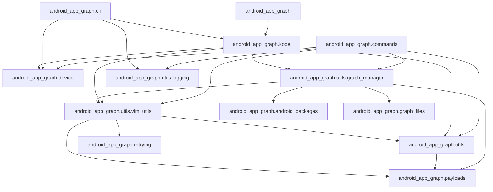

# Android-App-Graph

Android-App-Graph explores Android apps into UI state-transition graphs. It is a
fork of [UI-KOBE](https://github.com/YuxiangChai/UI-KOBE) by Yuxiang Chai.

## How It Works

1. **Explore an app.** Android-App-Graph opens an Android app on an emulator, observes the
   current screen, chooses an exploration action, and records the result.
2. **Build a graph.** Each app state becomes a graph node. Actions that move the
   app between states become graph edges.
3. **Audit and plot the graph.** `app-graph-audit` finds duplicate nodes and
   mislabelled edges and can correct them on the device; `app-graph-plot` draws
   the graph.

## Repository Layout

```text
Android-App-Graph/
├── src/
│   └── android_app_graph/             # The installable package; the only directory in the wheel
│       ├── cli.py                     # app-graph command
│       ├── commands/                  # app-graph-audit, app-graph-plot
│       ├── kobe.py                    # Core app explorer
│       └── utils/                     # Graph, VLM, and logging helpers
├── scripts/                           # Operator scripts, not packaged
│   └── run_explore.sh                 # Auto-resume wrapper around app-graph
└── configs/
    └── explore.yaml                   # Sanitized exploration demo config
```

`src/android_app_graph/` is the installable Python package: `uv build` produces a wheel
that contains the `android_app_graph` import package and nothing else.

`scripts/` and `configs/` deliberately stay at the repository root and are not
part of the wheel. `scripts/` holds only `run_explore.sh`, a shell wrapper
around the `app-graph` console script; the `app-graph-audit` and
`app-graph-plot` commands live in `src/android_app_graph/commands/` and ship
with the wheel. `configs/` holds example configuration.

Generated graphs, logs, and outputs are intentionally ignored by git.

### Module map

Import direction inside `src/android_app_graph/` is enforced by `tach check`
(part of `uv run --locked poe check-fast` and `poe check`) from `tach.toml`.
Arrows point from importer to imported module; anything not drawn is forbidden.



## Prerequisites

- Python >= 3.14. `.python-version` pins `3.14`; uv downloads a managed
  interpreter automatically if none is installed.
- [uv](https://docs.astral.sh/uv/) 0.12.9 or a newer 0.12.x release.
  `pyproject.toml` enforces the range `>=0.12.9,<0.13` with `required-version`;
  run `uv self update 0.12.9` if yours is outside it.
- Android SDK with `adb` on `PATH`
- A running emulator or a USB-debugging device on `adb devices`, with the target
  app installed. `device.udid` in the config is its serial. `device.avd_name`
  is read only when `adb devices` lists nothing: exploration then copies that
  AVD to `<avd_name>_dup` and starts the copy with `emulator`, which must be on
  `PATH`.
- VLM provider credentials exported as environment variables

## Install

```bash
git clone https://github.com/john-agi/Android-App-Graph.git
cd Android-App-Graph
uv sync
```

Run commands through `uv`:

```bash
uv run app-graph --help
```

## Configure API Credentials

Do not put API keys directly in config files. Use a local `.env` file instead:

```bash
cp .env.example .env
```

The official [OpenRouter Python SDK](https://openrouter.ai/docs/client-sdks/python/overview)
is installed by `uv sync --locked`. OpenRouter is the only endpoint and
`OPENROUTER_API_KEY` is the only credential: one key covers chat and text
embeddings, and a missing or empty key is an error:

```bash
OPENROUTER_API_KEY=your-key
```

Two optional variables, commented out in `.env.example`, attribute your requests to
your app in OpenRouter's rankings and analytics
([app attribution](https://openrouter.ai/docs/app-attribution)):
`OPENROUTER_HTTP_REFERER` (your app's URL) and `OPENROUTER_X_OPEN_ROUTER_TITLE`
(its name). The OpenRouter SDK reads them from the environment and sends them as
the `HTTP-Referer` and `X-OpenRouter-Title` headers.

Export `.env` into the environment before running commands:

```bash
set -a
source .env
set +a
```

`.env` is ignored by git. Keep all four model selections from
[`.env.example`](.env.example), or replace them with exact OpenRouter model IDs.
The application has no built-in model defaults. Each operation requires explicit,
nonempty model settings. It validates every setting it uses (models, temperatures,
timeouts, removed keys and `OPENROUTER_API_KEY`) before any device setup or API
request: `app-graph` and `app-graph-audit` report every problem in a one-line
usage error. You may also supply these environment variables directly in your
shell, CI or container; a physical `.env` file is not required or loaded
automatically.

| Environment variable | Role |
|---|---|
| `APP_GRAPH_PAGE_DETAIL_MODEL` | Screen descriptions and graph auditing |
| `APP_GRAPH_EMBEDDING_MODEL` | Text embeddings |
| `APP_GRAPH_INSTRUCTION_MODEL` | Exploration planning and relabelling flagged edges |
| `APP_GRAPH_ACTION_MODEL` | Action prediction |

The template's model selections were approved from OpenRouter's catalog based on
documented capabilities, the chat models on 2026-10-12 and the embedding model on
2026-10-21; Android-task improvements have not been measured.
Check a replacement model's supported input modalities and parameters in the
[chat catalog](https://openrouter.ai/api/v1/models) or
[embedding catalog](https://openrouter.ai/api/v1/embeddings/models).

The sample YAML uses `${APP_GRAPH_*_MODEL}` references. An omitted `model` field
reads the corresponding environment variable; an explicit model ID in YAML takes
precedence. An empty value or unresolved reference is an error.
To compare models, edit `.env`, export it again and restart the command.

Exploration requires all four roles. A basic audit requires page-detail and
embedding models; `--re-explore` also requires instruction and action models.
Help and plotting existing graphs need no model configuration or credentials.

Each chat role (`page_detail`, `instruction`, `action`) accepts an optional
`temperature` in its YAML block: a finite number from 0 to 2, inclusive, or an
`${ENV_VAR}` reference.
It is omitted by default. Only set it when the selected model and provider
support it; check the model's supported parameters and
[OpenRouter's parameter guidance](https://openrouter.ai/docs/api_reference/parameters).
The sample `configs/explore.yaml` sets `temperature: 0.0` on `action` only:
`qwen/qwen3.8-flash` supports it and upstream UI-KOBE used it, while Sol, the
sample's page-detail and instruction model, rejects temperature, so those blocks
leave it out. Zero temperature does not guarantee deterministic output.

### Requests and recovery

All model roles accept a positive, finite `request_timeout` (or `timeout`) in
seconds, sent with each request; the default is 60 seconds. The graph audit and
node-merge audit send the whole graph in one prompt, so they use
`page_detail.audit_request_timeout` instead, default 300 seconds.

The OpenRouter SDK retries transport failures with its default policy, which the
application keeps as is. It retries 5XX responses, dropped connections (refused,
reset or failed reads and writes) and timeouts with exponential backoff (0.5 s,
then ×1.5 per retry, plus up to 1 s of jitter, at most 60 s between tries) for up
to one hour, waiting as long as a 5XX response's `Retry-After` or `retry-after-ms`
header asks instead. It does not retry 429 or other 4xx responses, which fail at
once, nor a server that closes the connection without sending a response. The
application never retries what the SDK has given up on. A request that timed out
can be sent again within that hour, and OpenRouter bills a non-streaming request
in full even after the client disconnects, so a timeout shorter than the model
needs can pay for the same request several times.

The application asks a model once more, and only once, for output it cannot use:
a malformed page description, an action reply that cannot be parsed or converted,
an SDK validation failure on a 2xx response, an empty or non-finite embedding
vector, or a reply whose generation failed partway (`finish_reason: "error"`). If
the second attempt is unusable too, an action falls back to a one-second wait and
everything else raises; a failed generation never becomes a parse fallback.
Exploration counts waits toward `max_steps`, including recovery waits, so repeated
malformed actions cannot keep the run alive indefinitely.

An action reply that cannot be parsed or converted is asked again with what was
wrong, since at temperature 0 the same request can repeat the same mistake. The
second request repeats the instruction and screenshot, adds the failed reply as an
assistant message (omitted when the reply has no text), and ends with a user
message naming the problem: the `<tool_call>` block used `<function=...>` tags
instead of JSON, there was no `<tool_call>` block with valid JSON, or the
`mobile_use` arguments were invalid, quoting the conversion error. It then asks for
Thought, Action and one `<tool_call>` block of JSON, at the role's usual
temperature. Every other unusable reply, including a failed generation and an SDK
validation failure, is sent again unchanged.

No request sets `max_tokens`, so a reply stops only at the model's own output
limit. A reply cut off there (`finish_reason: "length"`) is never asked again,
since the same request would be cut off again. The log names the call and any
reasoning tokens, and the caller applies its final fallback at once: an action
waits, node verification treats the screens as different, edge normalization
and relabelling a flagged edge keep the instruction, the audits report no
issues, the coverage checkpoint uses its top candidate, and a page description
or an exploration plan raises. A reply stopped by the provider's content filter
(`finish_reason: "content_filter"`) is logged with the call's name and otherwise
handled like any other empty or partial reply.

The page-detail calls that return JSON (screen descriptions, node verification,
edge normalization, both audits and the coverage checkpoint's target choice),
the exploration planner, which names the unexplored element its instruction acts
on, and the instruction model's relabelling of a flagged edge ask for
[structured outputs](https://openrouter.ai/docs/guides/features/structured-outputs):
a JSON schema with a description of every property, plus OpenRouter's
[response-healing](https://openrouter.ai/docs/guides/features/plugins/response-healing)
plugin. The schemas are strict except for screen descriptions and edge templates,
whose `state` and `params` objects have free-form keys that strict mode cannot
express. OpenRouter routes a `response_format` only to providers that support it,
and not every provider enforces strict schemas, so every reply is still validated
as before. The action model keeps its text format.

Chat responses must include every field the SDK requires, including
`system_fingerprint`, which may be `null` but not omitted. A broken endpoint
response cannot become an action's fallback wait.

Exploration and `app-graph-audit` log a usage summary when they finish, per call
type and model: calls, prompt tokens and the cached share of them, completion
tokens and the reasoning share of them, total tokens, and cost in USD, as reported
by OpenRouter's [usage accounting](https://openrouter.ai/docs/guides/administration/usage-accounting).
For a request OpenRouter sends with your own provider key (BYOK), the cost adds the
provider's bill for it, `upstream_inference_cost`, to OpenRouter's charge, so it is
the full price even though the provider bills that part to your key directly.
Every completed reply counts, including one that was asked again or cut off,
since OpenRouter bills it; embedding replies report cost but no cached or
reasoning tokens.

Each command opens one OpenRouter client for the whole run, shares it across every
role and closes it when the run ends; each request carries its own role's model,
temperature and timeout.

### Upgrading provider configuration

OpenRouter is the only endpoint and `OPENROUTER_API_KEY` the only credential. A `page_detail`,
`embedding`, `instruction` or `action` block that still sets `api_key`,
`base_url` or `native_base_url` is rejected, with an error naming each key, by
every command, even in a block the operation does not use. Configs copied from
upstream UI-KOBE still set these keys: delete them and export
`OPENROUTER_API_KEY` instead.

### Embedding caches

Text sidecars (`*.emb.json`) store each node's vector with its exact model ID
as `{node_id: {"model": model_id, "embedding": vector}}`. Legacy bare vectors
and inline vectors without model metadata have unknown provenance. Graphs
can still be loaded for inspection, but text comparisons reject unknown or
mismatched models even when dimensions match. These checks run before description
or embedding requests, so a rejected graph does not spend on model calls.
Rebuild or re-explore into a new graph directory with the configured embedding
model before resuming text matching; do not relabel old vectors. Newly generated
or renamed descriptions carry their model metadata through save/load.

Exploration and the audit match screens by these text vectors and by comparing
screenshots, never by screenshot embeddings. A screenshot-embedding sidecar left
in a graph directory is not read; it can be deleted.

### Action responses

The action prompt declares the `mobile_use` function in its text format and gives
the screen resolution as 999x999 whatever the device or screenshot size; the
screenshot itself is still downscaled to at most one million pixels.
On ScreenSpot-v2 mobile (501 screenshots, temperature 0), `qwen/qwen3.8-flash`
hit the target in 94.2% of taps with that screen line, against 91.0% when the
prompt stated the resized screenshot size.

A `<tool_call>` block holds one JSON object, `{"name": ..., "arguments": {...}}`
or the arguments alone. A reply that ends before `</tool_call>` is still read when
its JSON object is complete. The `<function=mobile_use>` form, with one
`<parameter=name>` tag per argument, is not read: like any other reply that yields
no action, it is [asked again](#requests-and-recovery) with the reason.

Textual and native tool calls use the same action conversion. Click and long-press
coordinates must contain two finite numbers on the model's 0–1000 scale, which
are scaled to device pixels. A swipe uses two complete coordinate pairs when
provided; otherwise `up`, `down`, `left` or `right` works with omitted, null or
one valid coordinate pair. Supplied malformed coordinates still trigger
[action recovery](#requests-and-recovery). For swipes and long presses, a
numeric `time` takes precedence over `duration`; the default is 1000 milliseconds.
Unsupported swipe directions, unknown actions or system buttons, and type
actions without a text string trigger the same bounded action recovery.
Explicit `end` and `terminate` become an `end` action, which exploration and the
audit record as a back press.

## Explore an App

Edit `configs/explore.yaml` for your emulator and target app:

```yaml
device:
  udid: emulator-5554
  avd_name: AndroidWorldAvd

apps:
  - name: demo_app
    package_name: com.example.app
```

Run exploration:

```bash
set -a && source .env && set +a
uv run app-graph -c configs/explore.yaml
```

Useful options:

```bash
uv run app-graph -c configs/explore.yaml --max-steps 100
uv run app-graph -c configs/explore.yaml --resume-from auto --max-steps 50
```

Exploration writes graph files under `graphs/<app_name>/`.

Before exploring, and before `app-graph-audit --re-explore`, the app is granted
every permission it requests with `adb shell pm grant`, so no permission prompt
interrupts exploration. The grants stay on the device. Permissions that
`pm grant` refuses, such as `INTERNET`, are logged and skipped.

For long runs, use the auto-resume wrapper:

```bash
./scripts/run_explore.sh -c configs/explore.yaml
```

### Replaying to a node

`--resume-from`, the coverage checkpoint every `experiment.coverage_checkpoint_steps`
steps and each issue that `app-graph-audit --re-explore` works on reach their node
by replaying recorded actions from the app's start screen. Before every replay the
app is force-stopped (`adb shell am force-stop <package_name>`) and launched again,
through its `launch_activity` when the config sets one. Whatever the app holds only
in memory, such as an unsaved form, is lost at each replay; data it has stored
survives.

`--resume-from auto` resumes from the node the coverage checkpoint's ranking puts
first, without a model call. The ranking favours nodes with many unexplored
elements, few outgoing edges and few visits. Each checkpoint lets the model choose
among the `experiment.coverage_checkpoint_top_k` highest-ranked nodes, and also
offers the app's start screen while it has unexplored elements, in the last of
those places when it ranks below them.

### External apps and web pages

A step that opens another app records an edge to an `ext_<package>` node. A step
that opens web content from outside the app, such as a browser or custom tab
showing an address bar or URL, records an edge to the single shared `ext_web`
node. Either way the explorer then presses back. A redirecting link or a browser's
own history can keep an outside web page up, so the explorer presses back again,
a few times at most, and if the page is still showing restarts the app as before
a [replay](#replaying-to-a-node). It never records an edge out of an `ext_` node,
so a replay never passes through one. The screen-description model decides what
counts as external web, so the app's own screens get regular nodes even when they
run in a web view or mention a privacy policy. A permission prompt or system dialog
belongs to another package but sits on top of the app, so it gets a regular node
and no back press. The keyboard also belongs to another package; a page with the
keyboard shown shares the page's node, and the keyboard's visibility is recorded
in the node's state.
`app-graph-audit --re-explore` records external web pages and these dialogs the
same way.

Every node other than an `ext_` one records the package the device reported for
its screen, and the explorer and the audit match a screen only with nodes of its
package. A dialog's node is therefore never a target of
`--resume-from auto` or the coverage checkpoint, which replay from the app's start
screen. A node without a recorded package, other than an `ext_` one, takes the
graph file's `package_name`, or the app's configured `package_name` when the file
has none, so a graph file whose nodes record no package still loads and resumes.

### Graph edges

Each edge in a graph file lists its actions in `actions`. The `num_steps`,
`instructions`, `target_observations` and `schema_deltas` lists hold one entry
per action, in the same order, so entry *i* of each describes `actions[i]`. An
action that recorded no instruction or observation has `""` in that list, and an
action that recorded no state change has `null` in `schema_deltas`; only
self-loop actions record one. Skip those entries when you read an edge.

## Visualize or Audit a Graph

Create an HTML graph visualization. `app-graph-plot` needs the optional `viz` extra
(`pyvis` and `matplotlib`), which `uv sync` does not install by default; outside
this checkout, install it as `pip install "android-app-graph[viz]"`:

```bash
uv sync --extra viz
uv run --extra viz app-graph-plot graphs/<app_name>/<app_name>.json
```

Run the graph audit utility:

```bash
uv run app-graph-audit -c configs/explore.yaml --app <app_name>
```

### Correcting flagged edges

The audit asks the page-detail model for issues in a text dump of the graph and
saves them to `graphs/<app_name>/<app_name>_audit.json`. It merges the duplicate
nodes that a screenshot comparison confirms, normalizes edge templates and saves
the result to `<app_name>_audited.json`; the explored graph file is never
changed. Without `--re-explore`, no flagged edge is replayed or corrected.

Last, without a model call or a device, the audit adds `no_path_to_start` to
`<app_name>_audit.json`: the nodes of the final audited graph from which no
recorded edges lead back to `start_node`, the screen every
[replay](#replaying-to-a-node) begins from. It logs how many it found, as a
warning when `in_app` is not empty, and changes nothing in the graph.

- `in_app` lists the app's own screens whose way back was never recorded.
- `external` lists the `ext_` nodes. They keep no outgoing edge, so every one of
  them is listed.

Both lists use the node IDs of the file named in `graph`,
`<app_name>_audited.json`, not those of the model's issues, which predate the
merges. When the graph has no start node, `start_node` is `null` and both lists
are empty.

With `--re-explore`, the audit then works through the other issues on the
device, following the node IDs each issue names through those merges and through
renames made while it re-explores. For each `retry_edge` issue, an edge whose
instruction looks wrong for where it leads, it:

1. replays to the edge's source node (see [Replaying to a node](#replaying-to-a-node));
2. finds the flagged instruction on the edge by exact match, with the action
   recorded at the same position (see [Graph edges](#graph-edges));
3. executes that action once and corrects the edge by the screen it reaches:
   - another node: the action moves, with its entry in every per-action list, to
     the edge toward that node, which is created if needed, and its observation
     becomes that node's description. The flagged edge is removed once no action
     is left on it.
   - the edge's target: the transition is real and its label is wrong. The
     instruction model describes the action from the screenshot taken before it
     ran, and that description replaces the instruction.
4. replays to the source again, and stops if this replay misses it;
5. runs `--steps-per-issue` exploration steps from the source, with a hint about
   the flagged edge.

An edge that lost or changed an instruction drops its instruction templates, and
the final normalization rebuilds them. An `explore_node` issue replays to its
node and runs the same exploration steps, with a hint about the pages the
auditor expected.

Each issue's outcome is saved to `<app_name>_re_explore.json` as its `status`:

| `status` | Meaning | Graph |
|---|---|---|
| `moved` | The action reached the node in `moved_to` | Action moved |
| `relabelled` | The action reached the target | Instruction replaced by `instruction` |
| `relabel_failed` | The action reached the target, but the instruction model gave no usable description | Unchanged |
| `instruction_not_found` | The edge is gone, or the instruction is not on it word for word, for example because the auditor paraphrased it. Steps 3 and 4 are skipped | Unchanged |
| `unverified` | The replay missed the source, or the action left for an app with no `ext_<package>` node; `reached` is where it ended. Nothing is explored | Unchanged |
| `skipped` | The source node is not in the graph, or is an `ext_` node, which keeps no outgoing edge | Unchanged |

One replay can be misled by content that changes between runs, such as a feed;
the outcome records what each correction was based on.

## Verify Provider Setup

Install the checkout being tested with `uv sync --locked`, then follow
[Configure API Credentials](#configure-api-credentials). These manual checks
use a live provider and an emulator with your target app installed; they incur
model usage. Android-App-Graph is a Python package and does not produce an APK.

1. Copy `configs/explore.yaml` to `/tmp/app-graph-smoke.yaml`. Set `device.udid`,
   `device.avd_name` and the app's `name` and `package_name` for your emulator.
   Set `experiment.graph_dir` to a new scratch directory to keep existing graphs.
2. Run exploration, then resume with a higher total step limit:

   ```bash
   uv run --locked app-graph -c /tmp/app-graph-smoke.yaml --max-steps 2
   uv run --locked app-graph -c /tmp/app-graph-smoke.yaml --resume-from auto --max-steps 4
   ```

   Expect model-selected actions on the emulator, saved graph nodes and
   screenshots under the scratch directory, and model-tagged text vectors in
   the `.emb.json` sidecar. The second run should continue the saved graph.

## Development

This repository uses [uv](https://docs.astral.sh/uv/) as its only project
manager and [Poe the Poet](https://poethepoet.natn.io/) as its task runner.
The engineering contract for humans and coding agents is in
[AGENTS.md](AGENTS.md).
Multi-step maintenance procedures (adopting a tool, triaging a red Security
run, reviewing surviving mutants, reviewing the dead-code queue) are skills
under `.agents/skills/`, which Codex reads directly and Claude Code reads
through the `.claude/skills` symlink.

```bash
uv sync --locked                      # create .venv from uv.lock (Python 3.14)
uv run --locked poe fix               # apply safe Ruff autofixes and format (mutates files)
uv run --locked poe check-fast        # fast checks: format, lint, types (no mutations)
uv run --locked poe test-unit         # run the test suite without coverage
uv run --locked poe check             # definition of done; must exit 0 before a PR
uv run --locked poe dead-code-review  # 60% dead-code review queue (never a gate)
uv run --locked poe --help            # list every public task with its help text
```

`uv run --locked` refuses to run when `uv.lock` is stale. Add or remove
dependencies with `uv add` / `uv remove`, never by editing `uv.lock`, and
commit `pyproject.toml` and `uv.lock` together.

`uv run --locked poe check` also runs [zizmor](https://docs.zizmor.sh/) offline
against every workflow under `.github/workflows/`, so a workflow change that
unpins an action, widens `GITHUB_TOKEN` permissions or expands untrusted input
inside `run:` fails the definition of done locally and in CI. There is no
separate zizmor workflow; the CI `Quality` job runs `check`.

### Git hooks

The repository ships a `.pre-commit-config.yaml` for [prek](https://prek.j178.dev/), which `uv sync` installs as a dev dependency. Install the git shims once per clone:

```bash
uv run prek install --hook-type pre-commit --hook-type pre-push
```

- `git commit` runs `uv run --locked poe fix` and then `uv run --locked poe check-fast`. When `poe fix` changes files the commit is aborted with `files were modified by this hook`; review the changes, `git add` them and commit again.
- `git push` runs `uv run --locked poe check`, the full definition of done.

Run the stages on demand with `uv run prek run --all-files` (commit stage) and `uv run prek run --all-files --stage pre-push` (push stage). Hooks are a local convenience: the gate is CI, which runs the same `uv run --locked poe check` on every pull request.

## Acknowledgements

Android-App-Graph is a fork of [UI-KOBE](https://github.com/YuxiangChai/UI-KOBE)
by [Yuxiang Chai](https://github.com/YuxiangChai), released under the
[Apache License 2.0](LICENSE). Files from the original work have been modified
in this repository; the attribution notice is in [NOTICE](NOTICE).
The adb device controller and AVD manager in `src/android_app_graph/device.py`
are adapted from [AITK](https://github.com/YuxiangChai/AITK), a device toolkit
by the same author under the same licence; [NOTICE](NOTICE) names the files
they come from.
