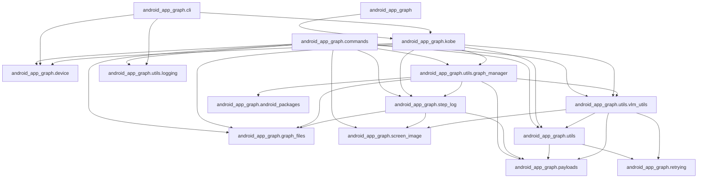

# Android-App-Graph

Android-App-Graph explores Android apps into UI state-transition graphs. It is a
fork of [UI-KOBE](https://github.com/YuxiangChai/UI-KOBE) by Yuxiang Chai.

## How It Works

1. **Explore an app.** Android-App-Graph opens an Android app on an emulator, observes the
   current screen, chooses an exploration action, and records the result.
2. **Build a graph.** Each app state becomes a graph node. Actions that move the
   app between states become graph edges.
3. **Audit and plot the graph.** `app-graph-audit` finds duplicate nodes and
   mislabelled edges and can correct them on the device; `app-graph-plot` draws
   the graph.

## Repository Layout

```text
Android-App-Graph/
├── src/
│   └── android_app_graph/             # The installable package; the only directory in the wheel
│       ├── cli.py                     # app-graph command
│       ├── commands/                  # app-graph-audit, app-graph-plot
│       ├── kobe.py                    # Core app explorer
│       ├── screen_image.py            # The WebP encoding every screenshot gets when taken
│       ├── step_log.py                # Records every screenshot and action in steps/
│       └── utils/                     # Graph, VLM, and logging helpers
├── scripts/                           # Operator scripts, not packaged
│   └── run_explore.sh                 # Auto-resume wrapper around app-graph
└── configs/
    └── explore.yaml                   # Sanitized exploration demo config
```

`src/android_app_graph/` is the installable Python package: `uv build` produces a wheel
that contains the `android_app_graph` import package and nothing else.

`scripts/` and `configs/` deliberately stay at the repository root and are not
part of the wheel. `scripts/` holds only `run_explore.sh`, a shell wrapper
around the `app-graph` console script; the `app-graph-audit` and
`app-graph-plot` commands live in `src/android_app_graph/commands/` and ship
with the wheel. `configs/` holds example configuration.

Generated graphs, logs, and outputs are intentionally ignored by git.

### Module map

Import direction inside `src/android_app_graph/` is enforced by `tach check`
(part of `uv run --locked poe check-fast` and `poe check`) from `tach.toml`.
Arrows point from importer to imported module; anything not drawn is forbidden.



## Prerequisites

- Python >= 3.14. `.python-version` pins `3.14`; uv downloads a managed
  interpreter automatically if none is installed.
- [uv](https://docs.astral.sh/uv/) 0.12.9 or a newer 0.12.x release.
  `pyproject.toml` enforces the range `>=0.12.9,<0.13` with `required-version`;
  run `uv self update 0.12.9` if yours is outside it.
- Android SDK with `adb` on `PATH`
- A running emulator or a USB-debugging device on `adb devices`, with the target
  app installed. `device.udid` in the config is its serial. `device.avd_name`
  is read only when `adb devices` lists nothing: exploration then copies that
  AVD to `<avd_name>_dup` and starts the copy with `emulator`, which must be on
  `PATH`.
- VLM provider credentials exported as environment variables

## Install

```bash
git clone https://github.com/john-agi/Android-App-Graph.git
cd Android-App-Graph
uv sync
```

Run commands through `uv`:

```bash
uv run app-graph --help
```

## Configure API Credentials

Do not put API keys directly in config files. Use a local `.env` file instead:

```bash
cp .env.example .env
```

The official [OpenRouter Python SDK](https://openrouter.ai/docs/client-sdks/python/overview)
is installed by `uv sync --locked`. OpenRouter is the only endpoint and
`OPENROUTER_API_KEY` is the only credential: one key covers chat, text embeddings
and screenshot embeddings, and a missing or empty key is an error:

```bash
OPENROUTER_API_KEY=your-key
```

Two optional variables, commented out in `.env.example`, attribute your requests to
your app in OpenRouter's rankings and analytics
([app attribution](https://openrouter.ai/docs/app-attribution)):
`OPENROUTER_HTTP_REFERER` (your app's URL) and `OPENROUTER_X_OPEN_ROUTER_TITLE`
(its name). The OpenRouter SDK reads them from the environment and sends them as
the `HTTP-Referer` and `X-OpenRouter-Title` headers.

Export `.env` into the environment before running commands:

```bash
set -a
source .env
set +a
```

`.env` is ignored by git. Keep all four model selections from
[`.env.example`](.env.example), or replace them with exact OpenRouter model IDs.
The application has no built-in model defaults. Each operation requires explicit,
nonempty model settings. Before any device setup or API request, `app-graph` and
`app-graph-audit` reject every config key that neither command uses, naming each
by its path, such as `vlm.action.max_tokens` or `apps[0].activity`, and
validate every setting the operation uses (models, temperatures, timeouts and
`OPENROUTER_API_KEY`); they report the problems in a one-line usage error.
`CONFIG_KEYS` in `src/android_app_graph/utils/__init__.py` lists the accepted
keys. You may also supply these environment variables directly in your shell, CI
or container; a physical `.env` file is not required or loaded automatically.

| Environment variable | Role |
|---|---|
| `APP_GRAPH_PAGE_DETAIL_MODEL` | Screen descriptions and graph auditing |
| `APP_GRAPH_EMBEDDING_MODEL` | Text and screenshot embeddings |
| `APP_GRAPH_INSTRUCTION_MODEL` | Exploration planning and relabelling flagged edges |
| `APP_GRAPH_ACTION_MODEL` | Action prediction |

The template's model selections were approved from OpenRouter's catalog based on
documented capabilities, the chat models on 2026-10-12 and the embedding model on
2026-10-21; their performance on Android tasks has not been measured.
Check a replacement model's supported input modalities and parameters in the
[chat catalog](https://openrouter.ai/api/v1/models) or
[embedding catalog](https://openrouter.ai/api/v1/embeddings/models).

The sample YAML uses `${APP_GRAPH_*_MODEL}` references. An omitted `model` field
reads the corresponding environment variable; an explicit model ID in YAML takes
precedence. An empty value or unresolved reference is an error.
To compare models, edit `.env`, export it again and restart the command.

Exploration requires every role: `page_detail`, `embedding`, `image_embedding`,
`instruction` and `action`. A basic audit requires `page_detail`, `embedding` and
`image_embedding`; `--re-explore` also requires `instruction` and `action`.
`image_embedding` embeds screenshots and takes the `embedding` model when its block
sets none (see [Requests and recovery](#requests-and-recovery)),
so the four variables above cover every role. Help and plotting existing graphs need
no model configuration or credentials.

Each chat role (`page_detail`, `instruction`, `action`) accepts an optional
`temperature` in its YAML block: a finite number from 0 to 2, inclusive, or an
`${ENV_VAR}` reference.
It is omitted by default. Only set it when the selected model and provider
support it; check the model's supported parameters and
[OpenRouter's parameter guidance](https://openrouter.ai/docs/api_reference/parameters).
The sample `configs/explore.yaml` sets `temperature: 0.0` on `action` only:
`qwen/qwen3.8-flash` supports it, while Sol, the sample's page-detail and
instruction model, rejects temperature, so those blocks leave it out. Zero
temperature does not guarantee deterministic output.

### Requests and recovery

All model roles accept a positive, finite `request_timeout` (or `timeout`) in
seconds, sent with each request; the default is 60 seconds. A screenshot embedding
takes the `embedding` block's timeout when the `image_embedding` block sets none.
The graph audit and node-merge audit send the whole graph in one prompt, so they use
`page_detail.audit_request_timeout` instead, default 300 seconds.

Each attempt ends at that timeout by the wall clock, counted from when the
request is sent, so connecting and the response headers count too. httpx's own
read timeout applies to each chunk of data, and OpenRouter keeps a non-streaming
connection open with whitespace every few seconds while the model works, so that
timeout alone would never fire. A connection that sends nothing at all still ends
at httpx's read timeout.

The OpenRouter SDK retries 5XX responses, dropped connections (refused, reset or
failed reads and writes) and timeouts with its default exponential backoff
(0.5 s, then ×1.5 per retry, plus up to 1 s of jitter, at most 60 s between
tries), waiting as long as a 5XX response's `Retry-After` or `retry-after-ms`
header asks instead. The application sends a request answered with 429 (too many
requests) again after the same backoff, or after as long as the response's
`Retry-After` header asks, in seconds or as a date, when that is positive and
ends by the deadline below. A backoff that would end past the deadline is cut
short to end at it, so no 429 is sent again after the deadline, and a 429 that
arrives at or past it fails at once. Each 429 sent again logs a warning naming
the call (`normalize_edge: rate limited (HTTP 429); sending again in 1.2 s`), so
the log shows how often the provider limited the run. Both share one deadline:
they stop once twice the request's timeout has passed since the first attempt,
so a timed-out attempt gets exactly one more, and 5XX and 429 responses are
retried for up to two minutes at the default timeout and ten minutes for the
audits, after which the last one fails. Other 4xx responses, including 402 (no
credit left), fail at once, as does a server that closes the connection without
sending a response. The application never retries what the SDK has given up on:
a call that still times out takes the fallback listed below for a truncated
reply, and a call without one raises. OpenRouter bills a non-streaming request
in full even after the client disconnects, so an attempt cut off at its deadline
is still billed, and a timeout shorter than the model needs pays for the same
request twice.

The application asks a model once more, and only once, for output it cannot use:
a malformed page description, an action reply that cannot be parsed or converted,
an SDK validation failure on a 2xx response, an empty or non-finite embedding
vector, or a reply whose generation failed partway (`finish_reason: "error"`). If
the second attempt is unusable too, an action falls back to a one-second wait and
everything else raises; a failed generation never becomes a parse fallback.
Exploration counts waits toward `max_steps`, including recovery waits, so repeated
malformed actions cannot keep the run alive indefinitely.

An action reply that cannot be parsed or converted is asked again with what was
wrong, since at temperature 0 the same request can repeat the same mistake. The
second request repeats the instruction and screenshot, adds the failed reply as an
assistant message (omitted when the reply has no text), and ends with a user
message naming the problem: the `<tool_call>` block used `<function=...>` tags
instead of JSON, there was no `<tool_call>` block with valid JSON, or the
`mobile_use` arguments were invalid, quoting the conversion error. It then asks for
Thought, Action and one `<tool_call>` block of JSON, at the role's usual
temperature. Every other unusable reply, including a failed generation and an SDK
validation failure, is sent again unchanged.

No request sets `max_tokens`, so a reply stops only at the model's own output
limit. A reply cut off there (`finish_reason: "length"`) is never asked again,
since the same request would be cut off again. The log names the call and any
reasoning tokens, and the caller applies its final fallback at once: an action
waits, node verification treats the screens as different, edge normalization
and relabelling a flagged edge keep the instruction, the audits report no
issues, the coverage checkpoint uses its top candidate, and a page description
or an exploration plan raises. A call that still times out after the SDK's
retries is logged with its name as timed out after retries and takes the same
fallback, so an action waits too; a page description, an exploration plan or an
embedding still raises. A reply stopped by the provider's content filter
(`finish_reason: "content_filter"`) is logged with the call's name and otherwise
handled like any other empty or partial reply.

The page-detail calls that return JSON (screen descriptions, node verification,
edge normalization, both audits and the coverage checkpoint's target choice),
the exploration planner, which names the unexplored element its instruction acts
on, and the instruction model's relabelling of a flagged edge ask for
[structured outputs](https://openrouter.ai/docs/guides/features/structured-outputs):
a JSON schema with a description of every property, plus OpenRouter's
[response-healing](https://openrouter.ai/docs/guides/features/plugins/response-healing)
plugin. The schemas are strict except for screen descriptions and edge templates,
whose `state` and `params` objects have free-form keys that strict mode cannot
express. OpenRouter routes a `response_format` only to providers that support it,
and not every provider enforces strict schemas, so the application validates every
reply itself. The action model replies in its own text format.

Chat responses must include every field the SDK requires, including
`system_fingerprint`, which may be `null` but not omitted. A broken endpoint
response cannot become an action's fallback wait.

Exploration and `app-graph-audit` log a usage summary when they finish, per call
type and model: calls, prompt tokens and the cached share of them, completion
tokens and the reasoning share of them, total tokens, and cost in USD, as reported
by OpenRouter's [usage accounting](https://openrouter.ai/docs/guides/administration/usage-accounting).
For a request OpenRouter sends with your own provider key (BYOK), the cost adds the
provider's bill for it, `upstream_inference_cost`, to OpenRouter's charge, so it is
the full price even though the provider bills that part to your key directly.
Every completed reply counts, including one that was asked again or cut off,
since OpenRouter bills it; embedding replies report cost but no cached or
reasoning tokens.

Each command opens one OpenRouter client for the whole run, shares it across every
role and closes it when the run ends; each request carries its own role's model,
temperature and timeout.

Edge normalization sends up to 16 requests at once: exploration's pass over a
node's outgoing edges at every tenth visit and its final pass over every edge,
and the audit's pass over every edge. Each request keeps its own timeout, retries
and fallback as above, and logs its own warnings, such as a timeout or a 429 sent
again, when they happen. The templates are written and logged in the graph's edge
order, whichever request is answered first, and the usage summary counts every
request. A request that raises, such as one refused for lack of credit or still
answered with 429 at its deadline, cancels the requests not yet sent; the
templates of those already answered are still written, and then the error stops
the command.

Every read of the screen, in exploration and in the audit, runs three adb
commands: the UI dump, the screenshot and `dumpsys window`. Each one that runs
longer than 30 seconds is stopped and run once more, with a warning naming the
command (`adb ... timed out after 30 s; retrying once`). A second timeout raises
`subprocess.TimeoutExpired`, which names the command and the timeout, and the run
fails as it does when any other adb command fails. A normal read takes at most
about 12 seconds, when a dump gives up waiting for an idle screen.

Screenshots are embedded through OpenRouter's
[multimodal embeddings API](https://openrouter.ai/docs/api_reference/embeddings), as
`image/webp`. `vlm.image_embedding` inherits the `embedding` model and timeout when
omitted; set its `model` or `request_timeout` to embed screenshots differently.
Image embeddings require an image-capable embedding model, such as the one in
`.env.example`: a text-only model fails the first screenshot request, which stops
the command.

### Embedding caches

Text sidecars (`*.emb.json`) store each node's vector with its exact model ID
as `{node_id: {"model": model_id, "embedding": vector}}`. Bare vectors
and inline vectors without model metadata have unknown provenance. Graphs
can still be loaded for inspection, but text comparisons reject unknown or
mismatched models even when dimensions match. These checks run before description
or embedding requests, so a rejected graph does not spend on model calls.
Rebuild or re-explore into a new graph directory with the configured embedding
model before resuming text matching; do not relabel old vectors. Newly generated
or renamed descriptions carry their model metadata through save/load.

Screenshot vectors live in the [step log](#step-log), `steps/image_emb.json`, as
`{"model": model_id, "embeddings": {observation_id: vector}}`, so the explored
graph and its audited copy share them. Every screenshot that
[screen matching](#screen-matching) takes is embedded once and kept. Nothing reads
the vector of any other screenshot, so none is made for the screens of other apps,
including one a Back press leaves in front, or for a screenshot read without being
matched, such as the one after a wait. A file tagged with another model counts as
empty after one warning. A damaged file stops exploration or the audit as it loads
the graph, before any member is embedded, with an error naming the file and the
damage: the file cannot be read or parsed, has no model tag or no `embeddings`
object, or holds a malformed or non-finite vector, named by observation. Nothing is
pruned, since observation IDs never change.

When exploration resumes a graph and when the audit loads one, every member of an
in-app node that has no vector is embedded first, as when `image_emb.json` is missing
or tagged with another model. The log names the count before and the cost after. To
embed every screenshot again, delete the file.

One 670x1490 WebP screenshot, embedded with `voyageai/voyage-multimodal-3.5`, was
1,782 prompt tokens and $0.000599 on 2026-10-21; Voyage bills images by pixel, so a
screenshot of at most one million pixels costs at most about $0.0006.

### Action responses

The action prompt declares the `mobile_use` function in its text format and gives
the screen resolution as 999x999 whatever the device or screenshot size; the
screenshot itself is still downscaled to at most one million pixels.
On ScreenSpot-v2 mobile (501 screenshots, temperature 0), `qwen/qwen3.8-flash`
hit the target in 94.2% of taps with that screen line.

A `<tool_call>` block holds one JSON object, `{"name": ..., "arguments": {...}}`
or the arguments alone. A reply that ends before `</tool_call>` is still read when
its JSON object is complete. The `<function=mobile_use>` form, with one
`<parameter=name>` tag per argument, is not read: like any other reply that yields
no action, it is [asked again](#requests-and-recovery) with the reason.

Textual and native tool calls use the same action conversion. Click and long-press
coordinates must contain two finite numbers on the model's 0–1000 scale, which
are scaled to device pixels. A swipe uses two complete coordinate pairs when
provided; otherwise `up`, `down`, `left` or `right` works with omitted, null or
one valid coordinate pair. Supplied malformed coordinates still trigger
[action recovery](#requests-and-recovery). For swipes and long presses, a
numeric `time` takes precedence over `duration`; the default is 1000 milliseconds.
Unsupported swipe directions, unknown actions or system buttons, and type
actions without a text string trigger the same bounded action recovery.
Explicit `end` and `terminate` become an `end` action, which exploration and the
audit record as a back press.

## Explore an App

Edit `configs/explore.yaml` for your emulator and target app:

```yaml
device:
  udid: emulator-5554
  avd_name: AndroidWorldAvd

apps:
  - name: demo_app
    package_name: com.example.app
```

Run exploration:

```bash
set -a && source .env && set +a
uv run app-graph -c configs/explore.yaml
```

Useful options:

```bash
uv run app-graph -c configs/explore.yaml --max-steps 100
uv run app-graph -c configs/explore.yaml --resume-from auto --max-steps 50
```

Exploration writes graph files under `graphs/<app_name>/` and records every
screenshot and action in its [step log](#step-log).

Before exploring, and before `app-graph-audit --re-explore`, the app is granted
every permission it requests with `adb shell pm grant`, so no permission prompt
interrupts exploration. The grants stay on the device. Permissions that
`pm grant` refuses, such as `INTERNET`, are logged and skipped.

For long runs, use the auto-resume wrapper:

```bash
./scripts/run_explore.sh -c configs/explore.yaml
```

### Replaying to a node

`--resume-from`, the coverage checkpoint every `experiment.coverage_checkpoint_steps`
steps, a step that plans Back on the start screen (below) and each issue that
`app-graph-audit --re-explore` works on reach their node by replaying recorded actions
from the app's start screen. Before every replay the
app is force-stopped (`adb shell am force-stop <package_name>`) and launched again
with its task cleared (`adb shell am start -n <component> -f 0x10008000`), so another
app's screen left in that task, such as a search screen the app opened, does not come
back. The component is the app's `launch_activity` when the config sets one, and
otherwise the package's launcher activity, looked up once per run; of several, the
first is used and a warning names the others. Whatever the app holds only in memory,
such as an unsaved form, is lost at each replay; data it has stored survives.

The replay follows the path that sends the fewest device actions, each edge
weighed by its cheapest action: the action's own steps and its
[setup](#graph-edges), so a path whose actions need no setup is preferred. On
each edge it sends that action's setup first, such as the swipe that scrolled a
list or the dropdown choice that filled in a form, so the action finds the screen
as exploration did. Exploration's log names each setup action, as in
`Replay 2/3: setup 1/1 on s30_apps via swipe`.

`--resume-from auto` resumes from the node the coverage checkpoint's ranking puts
first, without a model call. The ranking favours nodes with many unexplored
elements, few outgoing edges and few visits. Each checkpoint lets the model choose
among the `experiment.coverage_checkpoint_top_k` highest-ranked nodes, and also
offers the app's start screen while it has unexplored elements, in the last of
those places when it ranks below them.

Back on the start screen leaves the app for the home screen, and exploration then
restarts the app onto the same screen. So when an exploration step plans Back there,
or its action model answers `end`, which exploration records as Back, Back is not
pressed. The explorer chooses a node as a checkpoint does, among the ranked nodes
other than the start screen but without the checkpoint's merge audit, replays to it
and continues from it. The step counts toward `max_steps`, and its log line names the
node. In the step log, the replay's records have the `source` `navigation_replay` and
the screen read after it `coverage_checkpoint`. When no other node is ranked, Back is
pressed.

### External apps and web pages

A step that opens another app records an edge to an `ext_<package>` node. A step
that opens web content from outside the app, such as a browser or custom tab
showing an address bar or URL, records an edge to the single shared `ext_web`
node. Either way the element the step acted on is marked explored, as after a
step that stays in the app, and the explorer then presses back. A redirecting
link or a browser's
own history can keep an outside web page up, so the explorer presses back again,
a few times at most, and if the page is still showing restarts the app as before
a [replay](#replaying-to-a-node). Back can also leave another app in front, for
example when it only closed that app's keyboard. The explorer then restarts the
app the same way, force-stopping it before the launch, because a launch alone
resumes the app's task with the other app's screen still on top. If another app
is still in front after the restart, exploration stops with an error naming its
package. No screen of another app gets a node: whenever another app is in front
when the explorer identifies a screen, such as at the end of a replay, it restarts
the app first, and stops with the same error if the app does not come back. It
never records an edge out of an `ext_` node, so a replay never passes through one.
The screen-description model decides what
counts as external web, so the app's own screens get regular nodes even when they
run in a web view or mention a privacy policy. A permission prompt or system dialog
belongs to another package but sits on top of the app, so it gets a regular node
and no back press. The keyboard also belongs to another package; a page with the
keyboard shown shares the page's node, and the keyboard's visibility is recorded
in the node's state.
`app-graph-audit --re-explore` records external web pages and these dialogs the
same way. A re-explore step that opens another app records nothing; the audit
presses back, restarts the app if another app is still in front, and stops with
the same error if the restart does not bring the app back.

Every node other than an `ext_` one records the package the device reported for
its screen, and the explorer and the audit match a screen only with nodes of its
package. A dialog's node is therefore never a target of
`--resume-from auto` or the coverage checkpoint, which replay from the app's start
screen. A node without a recorded package, other than an `ext_` one, takes the
graph file's `package_name`, or the app's configured `package_name` when the file
has none, so a graph file whose nodes record no package loads and resumes too.

### Step log

Exploration and `app-graph-audit --re-explore` record every screenshot they take
and every action they send in `graphs/<app_name>/steps/`, which the explored graph
and its `_audited` copy share. Recording is always on.

Each step has a zero-padded number. Its record is `<id>.json`, and a screenshot
also has its image, `<id>.webp`. Every screenshot is encoded once, when it is
taken: shrunk with LANCZOS to at most one million pixels and saved as lossless
WebP. That image is the only copy kept: the models receive it and the graph refers
to it. The image is written before its record, so every record names an
image that exists. A later run continues the numbering after the highest record,
and an image a crash left without a record is ignored and its number reused.
`image_emb.json` beside them holds the screenshots' image vectors (see
[Embedding caches](#embedding-caches)).

Every record has `id`, `kind`, `run_id` (one per exploration or re-exploration
run), `run_kind` (`explore` or `audit`), `source`, a UTC `timestamp`, and the
`activity` and `package` of its screen:

| `kind` | Written for | Also holds |
|---|---|---|
| `observation` | each screenshot | `width` and `height` of its image, the `status_bar` frame, `status_bar_rows` and `pixel_hash`; `describe` and `identify` once [screen matching](#screen-matching) has taken it |
| `action` | each action sent to the device | `observation`, the run's latest screenshot before it (`null` when the run has none), and the `action` |
| `transition` | each edge the graph is given | `before` and `after` observation IDs, the planner's `instruction` and `element`, the executed `action`, and `from_node` and `to_node` as they were then |

An action or transition record takes `activity` and `package` from the screenshot
it was taken from. A replay acts without looking, so a replayed action names the
last screenshot before it, which can predate the app restart. The planner's
instruction can differ from the edge's: an action-model `end` is recorded on the
edge as "Press back".

The status bar's clock and icons change on their own, so `pixel_hash` leaves them
out. It is the SHA-256 of the image's decoded pixels, mode and size below its top
`status_bar_rows` rows. Those rows cover `status_bar`, `[left, top, right, bottom]`
in screen pixels, which every capture reads from the `statusBars` (`ITYPE_STATUS_BAR`
before Android 14) `InsetsSource` of the `dumpsys window` output it already reads
for the package and activity: `ceil(bottom * image height / screenshot height)`, and
3 rows more when encoding shrank the image, because shrinking with LANCZOS blends
each row into the 3 rows on either side of it. The frame follows the display cutout and the rotation; on a Pixel 9
emulator it is 142 of 2424 rows in portrait. A bar that is hidden, as in immersive
mode, not at the top, or not reported gives `null` and 0 rows, and the whole image
is hashed, which can miss an exact match but never invents one.

`describe` holds the screen description model's `page_description`, `state`,
`elements` and `is_external_web`; an exact match copies them from the member it
matched and names it in `copied_from`. `identify` holds what decided the screen's
node:

- `stage`: `exact`, `expected`, `short_list`, `new` or `external_web`;
- `expected_node`, the node the caller expected, or `null`;
- `exact_match`, the member an exact match copied;
- `candidates`: each short-list node with the `sources` that proposed it and their
  scores, its `closest_member` and that member's `image_score`;
- `verifications`: each verifier call's `node`, the `member` it was shown, `same` and
  the `reason`;
- `refinement`: the descriptions the step's first rejection refined, and what the
  rejected node was renamed to, or `null`;
- `node`, the node the screen joined, under its ID at that moment.

`source` names the part of the run that took the step: `main_loop`,
`navigation_replay`, `coverage_checkpoint`, `external_app_recovery`,
`external_web_recovery`, `re_explore` (the audit's exploration steps) or
`edge_retry` (the audit's replay of a flagged edge). A retried edge has no
planner, so its transition holds the flagged instruction and a `null` element.

On 139 screenshots of the Settings app from a 1280x2856 emulator, each became a
669x1493 image of 74 KB on average (176 KB at most) and took about 0.35 s to
encode. An action or transition record is a few hundred bytes, and an identified
observation's record about 2 KB; each vector in `image_emb.json` adds about 14 KB.
The log keeps every value shown on the screen and every text typed, passwords
included, so treat a graph directory like the app's data. Run one exploration or
re-exploration of an app at a time: two runs writing one step log reuse each
other's numbers.

### Graph nodes

Each node lists the observations assigned to it in `observations`, in step
order, and names one of them `representative_observation`:

- a new node's representative is its first observation;
- a later visit matched to the node joins the list and keeps the representative;
- a screen the verifier rejects starts a new node with itself as representative;
- a merge unites both lists in step order and keeps the kept node's representative.

Screen matching verifies a screen against a node's member closest to it by image.
The audit's merge checks compare the two nodes' representative images in `steps/`,
and `app-graph-plot` shows the representative as the node's thumbnail. `ext_web` and
`ext_<package>` nodes list the screens that reached them as well; neither screen
matching nor the merge checks compare them.

#### Screen matching

Exploration and `app-graph-audit --re-explore` assign every screenshot of the app to
a node by comparing it with the members of the app's nodes of the same package,
cheapest evidence first. The screenshot's [`identify`](#step-log) field records
what each step found.

1. **Image embedding.** The screenshot is embedded (see
   [Embedding caches](#embedding-caches)).
2. **Exact match.** A member with the screenshot's `pixel_hash` decides alone when
   every such member belongs to one node: the screen copies that member's
   description, state and elements, so neither the description model nor the
   verifier runs. Members of two nodes with the same hash decide nothing.
3. **Description.** The description model describes the screen; web content from
   outside the app goes to `ext_web`. The description is embedded.
4. **Expected node.** Where the caller knows where the screen should be, that node is
   verified first, against its member closest to the screen: the node a replay leads
   to, the screen a step left when Back closes an outside web page or another app, the
   start node after a restart, and the target of the audit's retried edge. A
   confirmation decides; a rejection leaves the node off the short list.
5. **Short list.** Two sources rank the other nodes: `image`, by the image cosine of
   each node's closest member, proposes 3, and `text`, by the cosine of the
   description embeddings, proposes 2. The nodes are taken once each, in the order of
   their best rank in either source, ties broken by image cosine. The verifier checks
   them in that order against each one's closest member and stops at the first
   confirmation, after 3 calls at most (4 with an expected node).
6. **New node.** A screen every check rejects starts a new node with itself as
   representative. The step's first rejection refines the descriptions of both the
   screen and the rejected node, which is renamed after its new description; later
   rejections refine nothing.

A member without an image vector of the screenshot's dimension stops the command with
an error naming it and its node.

The graph file's `node_aliases` maps each node ID a rename or merge retired to
the ID that replaced it, so a node ID recorded in the step log by an earlier run
still resolves.

Loading a graph fails, naming the nodes, when a node lists no observations, its
representative is not one of them, or the representative's image is missing from
`steps/`. A graph whose nodes do not list their observations cannot be loaded:
explore the app again into a new graph directory.

### Graph edges

Each edge in a graph file lists its actions in `actions`. The `num_steps`,
`instructions`, `target_observations`, `schema_deltas` and `setups` lists hold
one entry per action, in the same order, so entry *i* of each describes
`actions[i]`. An action that recorded no instruction or observation has `""` in
that list, and an action that recorded no state change has `null` in
`schema_deltas`; only self-loop actions record one. Skip those entries when you
read an edge.

An action's entry in `setups` is the list of device actions exploration sent on
the edge's source node before it, since it last arrived at that node from
elsewhere; a [replay](#replaying-to-a-node) sends them first. They are the
node's self-loops, such as a swipe that scrolled a list down to the tapped row,
and its round trips, actions that left the node and came back to it, such as
opening a form's dropdown and choosing the option that shows the tapped field,
or opening one of a list's rows and pressing Back. Exploration keeps the nodes
it arrived at in order: coming back to one of them ends a round trip, and
arriving at any other node starts that node's setup empty, `[]`.
`app-graph-audit --re-explore` records setups the same way. The entry is `null`
when the setup is unknown or too long:

- How the device came to be on a screen is unknown on the screen a run begins
  on without a replay, after a step that leaves the app, and after a replay that
  ends elsewhere than its node, until exploration arrives at that screen from
  another one.
- A setup of more than 8 actions is dropped, and the log says so.

An action recorded again keeps the shorter of its known setups. A graph file
without `setups` loads unchanged, and its actions replay without a setup.

## Visualize or Audit a Graph

Create an HTML graph visualization. `app-graph-plot` needs the optional `viz` extra
(`pyvis` and `matplotlib`), which `uv sync` does not install by default; outside
this checkout, install it as `pip install "android-app-graph[viz]"`:

```bash
uv sync --extra viz
uv run --extra viz app-graph-plot graphs/<app_name>/<app_name>.json
```

In the HTML view, each node's label ends with the number of screenshots the node
holds, such as `[12 screenshots]`. Clicking a node opens a panel with its member
screenshots, oldest first and at most ten, with Previous and Next buttons and the
position, such as `3 / 10`. A member whose image is missing from `steps/` is
skipped. Clicking the background or an edge closes the panel.

Hovering a node shows its ID, full page description, activity, visits, state keys,
explored element count and first ten unexplored elements, then its representative
screenshot. Every value from the graph is shown as text, never read as HTML.

The images are embedded in the HTML as data URIs, so the file opens anywhere
without its step log. Base64 adds a third to each WebP: every member shown adds
about 100 KB for the Settings screenshots measured in [Step log](#step-log), 235 KB
at most. The tooltip shows the panel's copy of the representative, so a node embeds
one more image only when the panel does not show its representative. A Settings
graph of 82 nodes holding 232 screenshots plots to a 22 MB file.

Run the graph audit utility:

```bash
uv run app-graph-audit -c configs/explore.yaml --app <app_name>
```

### Correcting flagged edges

The audit asks the page-detail model for issues in a text dump of the graph and
saves them to `graphs/<app_name>/<app_name>_audit.json`. It merges the duplicate
nodes that a comparison of their representatives confirms, normalizes edge
templates and saves the result to `<app_name>_audited.json`; the explored graph
file is never changed. Without `--re-explore`, no flagged edge is replayed or
corrected.

Last, without a model call or a device, the audit adds `no_path_to_start` to
`<app_name>_audit.json`: the nodes of the final audited graph from which no
recorded edges lead back to `start_node`, the screen every
[replay](#replaying-to-a-node) begins from. It logs how many it found, as a
warning when `in_app` is not empty, and changes nothing in the graph.

- `in_app` lists the app's own screens whose way back was never recorded.
- `external` lists the `ext_` nodes. They keep no outgoing edge, so every one of
  them is listed.

Both lists use the node IDs of the file named in `graph`,
`<app_name>_audited.json`, not those of the model's issues, which predate the
merges. When the graph has no start node, `start_node` is `null` and both lists
are empty.

With `--re-explore`, the audit then works through the other issues on the
device, following the node IDs each issue names through those merges and through
renames made while it re-explores. For each `retry_edge` issue, an edge whose
instruction looks wrong for where it leads, it:

1. replays to the edge's source node (see [Replaying to a node](#replaying-to-a-node));
2. finds the flagged instruction on the edge by exact match, with the action
   recorded at the same position (see [Graph edges](#graph-edges));
3. executes that action once, after its [setup](#graph-edges), and corrects the
   edge by the screen it reaches:
   - another node: the action moves, with its entry in every per-action list, to
     the edge toward that node, which is created if needed, and its observation
     becomes that node's description. The flagged edge is removed once no action
     is left on it.
   - the edge's target: the transition is real and its label is wrong. The
     instruction model describes the action from the screenshot taken before it
     ran, and that description replaces the instruction.
4. replays to the source again, and stops if this replay misses it;
5. runs `--steps-per-issue` exploration steps from the source, with a hint about
   the flagged edge.

An edge that lost or changed an instruction drops its instruction templates, and
the final normalization rebuilds them. An `explore_node` issue replays to its
node and runs the same exploration steps, with a hint about the pages the
auditor expected.

Each issue's outcome is saved to `<app_name>_re_explore.json` as its `status`:

| `status` | Meaning | Graph |
|---|---|---|
| `moved` | The action reached the node in `moved_to` | Action moved |
| `relabelled` | The action reached the target | Instruction replaced by `instruction` |
| `relabel_failed` | The action reached the target, but the instruction model gave no usable description | Unchanged |
| `instruction_not_found` | The edge is gone, or the instruction is not on it word for word, for example because the auditor paraphrased it. Steps 3 and 4 are skipped | Unchanged |
| `unverified` | The replay missed the source, or the action left for an app with no `ext_<package>` node; `reached` is where it ended. Nothing is explored | Unchanged |
| `skipped` | The source node is not in the graph, or is an `ext_` node, which keeps no outgoing edge | Unchanged |

One replay can be misled by content that changes between runs, such as a feed;
the outcome records what each correction was based on.

## Verify Provider Setup

Install the checkout being tested with `uv sync --locked`, then follow
[Configure API Credentials](#configure-api-credentials). These manual checks
use a live provider and an emulator with your target app installed; they incur
model usage. Android-App-Graph is a Python package and does not produce an APK.

1. Copy `configs/explore.yaml` to `/tmp/app-graph-smoke.yaml`. Set `device.udid`,
   `device.avd_name` and the app's `name` and `package_name` for your emulator.
   Set `experiment.graph_dir` to a new scratch directory to keep existing graphs.
2. Run exploration, then resume with a higher total step limit:

   ```bash
   uv run --locked app-graph -c /tmp/app-graph-smoke.yaml --max-steps 2
   uv run --locked app-graph -c /tmp/app-graph-smoke.yaml --resume-from auto --max-steps 4
   ```

   Expect model-selected actions on the emulator, saved graph nodes that each
   list their `observations`, a `.webp` image and an `observation` record in
   `<app_name>/steps/` for every screenshot, and model-tagged text vectors in the
   `.emb.json` sidecar. The second run should continue the saved graph and the
   step numbering. The models receive every screenshot as `image/webp`, so a
   provider that rejects it fails the first screen description or the first
   screenshot embedding.

   Also expect:

   - `<app_name>/steps/image_emb.json` tagged with the embedding model, with a
     vector for every observation whose record has an `identify` field;
   - `pixel_hash`, `status_bar_rows`, `describe` and `identify` on those observation
     records, and a `status_bar_rows` above 0 on an emulator that shows its status
     bar;
   - an `image_embedding:<model>` row in the usage summary each run logs.

## Development

This repository uses [uv](https://docs.astral.sh/uv/) as its only project
manager and [Poe the Poet](https://poethepoet.natn.io/) as its task runner.
The engineering contract for humans and coding agents is in
[AGENTS.md](AGENTS.md).
Multi-step maintenance procedures (adopting a tool, triaging a red Security
run, reviewing surviving mutants, reviewing the dead-code queue) are skills
under `.agents/skills/`, which Codex reads directly and Claude Code reads
through the `.claude/skills` symlink.

```bash
uv sync --locked                      # create .venv from uv.lock (Python 3.14)
uv run --locked poe fix               # apply safe Ruff autofixes and format (mutates files)
uv run --locked poe check-fast        # fast checks: format, lint, types (no mutations)
uv run --locked poe test-unit         # run the test suite without coverage
uv run --locked poe check             # definition of done; must exit 0 before a PR
uv run --locked poe dead-code-review  # 60% dead-code review queue (never a gate)
uv run --locked poe --help            # list every public task with its help text
```

`uv run --locked` refuses to run when `uv.lock` is stale. Add or remove
dependencies with `uv add` / `uv remove`, never by editing `uv.lock`, and
commit `pyproject.toml` and `uv.lock` together.

`uv run --locked poe check` also runs [zizmor](https://docs.zizmor.sh/) offline
against every workflow under `.github/workflows/`, so a workflow change that
unpins an action, widens `GITHUB_TOKEN` permissions or expands untrusted input
inside `run:` fails the definition of done locally and in CI. There is no
separate zizmor workflow; the CI `Quality` job runs `check`.

### Git hooks

The repository ships a `.pre-commit-config.yaml` for [prek](https://prek.j178.dev/), which `uv sync` installs as a dev dependency. Install the git shims once per clone:

```bash
uv run prek install --hook-type pre-commit --hook-type pre-push
```

- `git commit` runs `uv run --locked poe fix` and then `uv run --locked poe check-fast`. When `poe fix` changes files the commit is aborted with `files were modified by this hook`; review the changes, `git add` them and commit again.
- `git push` runs `uv run --locked poe check`, the full definition of done.

Run the stages on demand with `uv run prek run --all-files` (commit stage) and `uv run prek run --all-files --stage pre-push` (push stage). Hooks are a local convenience: the gate is CI, which runs the same `uv run --locked poe check` on every pull request.

## Acknowledgements

Android-App-Graph is a fork of [UI-KOBE](https://github.com/YuxiangChai/UI-KOBE)
by [Yuxiang Chai](https://github.com/YuxiangChai), released under the
[Apache License 2.0](LICENSE). Files from the original work have been modified
in this repository; the attribution notice is in [NOTICE](NOTICE).
The adb device controller and AVD manager in `src/android_app_graph/device.py`
are adapted from [AITK](https://github.com/YuxiangChai/AITK), a device toolkit
by the same author under the same licence; [NOTICE](NOTICE) names the files
they come from.
